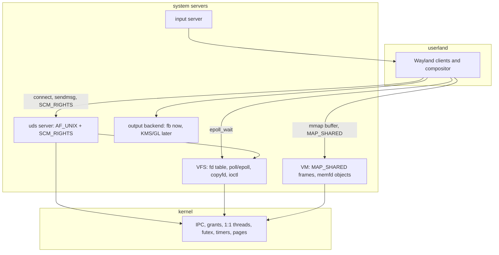
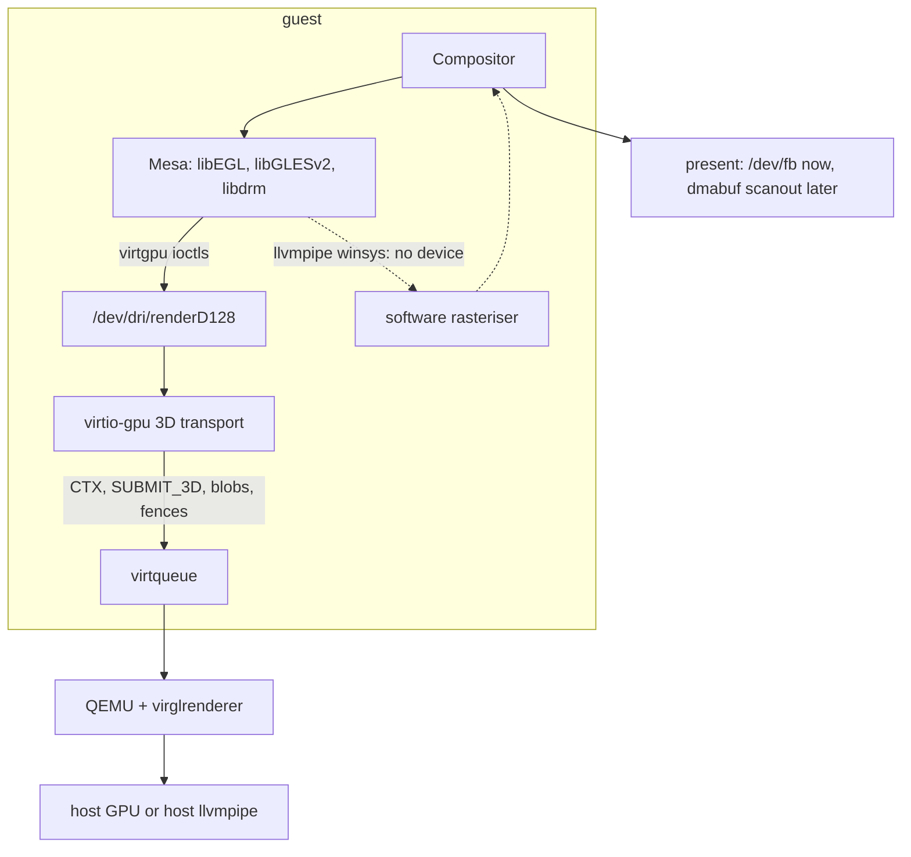

# Wayland on minixrs — design proposal and gap analysis

Status: **Phases 0–2 landed, and Phase 3 through stage 3d-b-5, with
the softpipe triangle (3c-2) on all three arches.** The loader support it
depends on has landed (dynamic linking, `dlopen`, multi-module TLS, an 18-object
budget — §6.9). §7 carries the per-phase state; what remains is Phase 2's
multi-output and Phases 4–5. The softpipe triangle
(3c-2) passes `just test-gltriangle-<arch>` on x86_64, riscv64 and aarch64 — EGL
1.5 / GLES 3.1 on `softpipe`, a red centroid over a black corner — the virgl
triangle (3c-3) passes `just test-gltriangle-virgl-x86` on the render node
(`GL_RENDERER=virgl`), and a GL surface reaches `/dev/fb` through the in-house
compositor (3d-a, `just test-wlgl-x86`). CI builds the stack per arch and injects
it into the released
system image. This
document proposes how to get a Wayland compositor — and eventually a desktop —
running on this port, and records what the reference tree has that we do not, so
the deviations are deliberate rather than accidental.

North star: `cosmic-comp` (System76 COSMIC, built on **smithay**) on screen, at
which point a Wayland session is a distribution-grade port rather than a demo.
First deliverable: a **real Wayland server running an unmodified `wl_shm`
client**, presenting to `/dev/fb` in QEMU.

There is prior art in-tree: the reference implements UNIX domain sockets
(`.refs/minix-3.3.0/minix/drivers/net/uds/`) with `SCM_RIGHTS` fd passing. That
is a design to study, not to copy wholesale — §5 records where we should deviate.

---

## 1. Scope

**In scope**

- The OS primitives Wayland needs: local sockets, fd passing, a scalable
  readiness API, shared buffers.
- A display output path and an input path the compositor can consume.
- A compositor: first in-house, later smithay/`cosmic-comp`.

**Out of scope (initially)**

- GL fidelity (blur/shadows/dmabuf) — Phase 3.
- A full session (D-Bus, portals, logind) — Phase 4.
- The `libcosmic` app suite — Phase 5.
- The **wasm32** target. A browser has no sockets, fds or `SCM_RIGHTS`; the web
  demo keeps its own `WS_*` protocol. The wasm port must not constrain this
  design.

---

## 2. Why Wayland is a good forcing function

The capability set is not "graphics"; it is a specific, bounded list of OS
services that a Wayland session exercises end to end. Implementing them pays
off beyond the desktop:



- AF_UNIX + fd passing ⇒ also unlocks D-Bus, `systemd`-style socket activation,
  and `SCM_RIGHTS`-based privilege separation generally.
- `poll`/`epoll` + `eventfd`/`timerfd` ⇒ any event-driven server, not just a
  compositor.
- shared buffers + `memfd` ⇒ a real answer for `shmget`-class IPC, which is
  currently half-built (§4).
- dynamic loading ⇒ the loader grew the way a real userspace needs it
  (`dlopen`, multi-module TLS, an 18-object budget), so the C graphics stack can
  be built as **shared objects** rather than linked into every binary.
- an output abstraction ⇒ a place for the virtio-gpu driver to become useful.

---

## 3. Inventory

Paths are in this tree (`minixrs/crates/...`) unless noted.

### 3.1 What we have

- [x] **Framebuffer device** — `/dev/fb` driver with bochs-display (x86),
      **virtio-gpu** (riscv64/aarch64) and canvas (wasm) backends;
      `FBIOFLUSH`/`FBIO*` ioctls; device `mmap`. `crates/servers/src/fb.rs`,
      `crates/drivers/src/video/{fb,virtio_gpu,tda19988}.rs`.
- [x] **A compositor** — `/sbin/wserver` (boot proc 18): windows, title-bar
      chrome, close button, resize grips, pointer hit-testing, key routing,
      whole-repaint on window change and cell-repaint on flush.
      `crates/servers/src/wserver.rs`, protocol in
      `crates/minix-std/src/wserver.rs`.
- [x] **Input server** — `/sbin/input`: PS/2 (`8042`) and virtio-input, decoded
      to **HID records** (keyboard page `0x07`, pointer pages `0x01`/`0xFD`/`0x09`),
      delivered by IRQ notification. `crates/servers/src/input.rs`,
      `crates/drivers/src/input/`.
- [x] **`select(2)`** — VFS `select` with the CDEV select protocol
      (`CDEV_SEL1_REPLY`/`CDEV_SEL2_REPLY`, driver-side `sel_endpt`/`sel_ops`).
      `crates/servers/src/vfs/select.rs`. A driver that cannot *send* a readiness
      report because VFS is busy ends the change with a `NOTIFY` instead, and VFS
      re-asks its suspended waits (`rescan_suspended`) — `KNOWN_ISSUES` 36.
- [x] **`ioctl(2)` with magic grants** — VFS `do_ioctl` → `CDEV_IOCTL`, argument
      struct moved by grant with direction from `_IOW`/`_IOR`.
      `crates/servers/src/vfs/device.rs`.
- [x] **Grabs / grants / copies** — `cpf_grant_*`, `SYS_VIRCOPY`,
      `SYS_SAFECOPY*`, and **`VFS_COPYFD`** (`COPYFD_FROM`/`COPYFD_TO`,
      `do_copyfd`) — the fd-duplication primitive fd passing is built on.
      `crates/servers/src/vfs/filedes.rs`, `crates/minix-std/src/lib.rs`.
- [x] **`mmap`** — anonymous, file-backed (via VFS `FDLOOKUP`, lazy, COW), and
      device (`VR_DIRECT`). `crates/servers/src/vm/mod.rs`.
- [x] **Writable `MAP_SHARED` file mappings** — `VR_SHARED`: shared cache frames
      rather than private copies, with an explicit COW exception at fork
      (`crates/servers/src/vm/{cow.rs,region.rs}`). **The reference rejects
      these** (§4) — this is a pre-existing deliberate deviation, and it is
      exactly the capability `wl_shm` needs.
- [x] **COW fork with shared-frame alias tracking** — `cow_setup_fork`,
      `handle_cow_fault`.
- [x] **`mprotect`** — a net-new VM call (`VM_MPROTECT`, §5 row 19): the region
      carries the new `VR_*` permission bits (what a *later* fault consults) and
      the PTEs of pages already present are re-mapped. The page-fault path now
      **enforces** region permissions (§8), which it never had to before.
      Gates `just test-memfd-x86` (steps 21–41: read-only protection, enforcement
      across a fork, restore, and a split sub-range).
- [x] **`select(2)` / `poll(2)` with real deadlines** — one VFS readiness engine
      (`crates/servers/src/vfs/select.rs`) and a `SYS_SETALARM`-backed deadline
      (`crates/servers/src/vfs/alarm.rs`), shared by both calls. Gated by
      `just test-select-x86` (`/bin/seltest`). §5 row 3, §6.3.
- [x] **`eventfd`** — a VFS-internal 64-bit counter (`crates/servers/src/vfs/eventfd.rs`)
      whose readiness the same engine watches, woken by a write from another
      process. Gated by `just test-eventfd-x86` (`/bin/eventfdtest`). §5 row 20.
- [x] **Anonymous VFS-owned objects** — the vnode + descriptor + filp wiring
      `memfd` and `eventfd` share (`crates/servers/src/vfs/anon.rs`): no
      filesystem behind the vnode (`v_fs_e` = NONE, `v_fs_count` = 0).
- [x] **1:1 kernel threads + `futex` + TLS** — `SYS_thread_*`, `SYS_futex_*`,
      pthreads in `minix-libc`. `crates/kernel/src/thread.rs`.
- [x] **Signals** — kernel `SYS_KILL/GETKSIG/ENDKSIG/SIGSEND/SIGRETURN`; PM
      `sigaction`/`sigprocmask`/`sigsuspend`/`sigreturn`.
- [x] **PTYs and pipes** — 4 static PTY pairs + line discipline
      (`crates/drivers/src/tty/pty.rs`, `crates/servers/src/tty.rs`), `pfs`
      pipe FS, `VFS_PIPE2`.
- [x] **Console cell model + bitmap font** — `crates/servers/src/console.rs`,
      `crates/minix-std/src/font.rs` (`FONT_8X16`).
- [x] **Dynamic `/dev`** — `devman` over VTreeFS.
- [x] **SysV IPC data structures** — semaphores and shm
      (`crates/servers/src/ipc.rs`: `do_shmget`/`do_shmat`/`do_shmdt`/`do_shmctl`)
      — implemented but unreachable (see §4).
- [x] **A C/C++ cross-build path** — `tools/cc-minix.py`, `tools/ccflags.py`,
      `just libcxx-x86`. Needed for any C dependency later (Mesa, xkbcommon).
- [x] **Dynamic linking** — landed on `main` for all three hardware arches: a
      Rust loader at `/libexec/ld.so` (`crates/ldso`), a shared C library
      (`/lib/libc.so`), and PIC targets in the fork (`*-minix-elf`). Default
      stays static, exactly as MINIX does. **`dlopen`/`dlsym`** work at run time
      (with `RTLD_LOCAL`/`RTLD_GLOBAL` groups), **TLS is multi-module** (a
      `dlopen`ed object with `__thread` state gets a reserved slice), and a
      program fits **18 shared objects** (`MAX_REGIONS = 64`, 3 regions per
      object). Read-only DSO text is shared across processes by the inode-keyed
      file page cache (`crates/servers/src/vm/cache.rs`); measured 13/13 pages
      (x86_64) and 11/11 (riscv64). `.notes/dynamic_linking.md`.
- [x] **Static Rust `std` PAL**, `procfs`, `mfs`, `ext2`, `pfs`, `pfs`-style
      services, `virtio-net` + net server, `ramdisk`, `ahci`, `at_wini`,
      `virtio_blk`.

### 3.2 What is missing for Wayland

Organised by critical path. Each is a real gap, with evidence.

**Tier 0 — IPC and OS primitives (blocking everything)**

- [ ] **AF_UNIX / local-domain sockets.** `AF_UNIX` is a constant
      (`crates/minix-std/src/net.rs`) and nothing more; `socket()` accepts
      `AF_INET` only and returns `EPROTONOSUPPORT` for local.
- [ ] **`socketpair(2)`.** Not defined anywhere.
- [ ] **`sendmsg(2)`/`recvmsg(2)`, `struct msghdr`, `iovec`.** Only
      `send`/`recv`/`sendto`/`recvfrom` exist.
- [ ] **`SCM_RIGHTS` fd passing** (+ `SCM_CREDS` / `SO_PEERCRED`). No ancillary
      data path at all. Note `VFS_COPYFD` (the primitive) *does* exist.
- [x] **`select(2)` and `poll(2)` with a real timeout.** Both live in one VFS
      readiness engine (`crates/servers/src/vfs/select.rs`) and share a deadline
      armed through `SYS_SETALARM` (`crates/servers/src/vfs/alarm.rs`); before
      this a bounded timeout blocked forever. `poll` is native, not emulated
      over `select`, and `minix-libc` now exports both `poll` and `select`.
      Gated by `just test-select-x86` (`/bin/seltest`). See §6.3.
- [x] **`epoll` (`epoll_create1`/`epoll_ctl`/`epoll_wait`).** A VFS-internal
      instance with a **persistent interest set** (`crates/servers/src/vfs/epoll.rs`);
      `epoll_wait` copies that set into one wait entry of the same readiness
      engine (`vfs/select.rs`) and scans it as `poll` does, so a driver reply, a
      `wake_object`, or the shared deadline completes it. Gated by
      `just test-epoll-x86` (`/bin/epolltest`). See §5 row 23, §6.3.
- [x] **`eventfd`.** A VFS-internal 64-bit counter (`crates/servers/src/vfs/eventfd.rs`),
      like `memfd`: a synthetic identity, no filesystem, VFS answers `read`/`write`.
      A blocked `poll`/`select` on it is woken by a write from another process
      (`vfs::select::wake_eventfd`) — no driver round-trip. Gated by
      `just test-eventfd-x86` (`/bin/eventfdtest`). See §5 row 20, §6.3.
- [x] **`timerfd`.** A VFS-internal timer object
      (`crates/servers/src/vfs/timerfd.rs`) in the `eventfd`/`memfd` shape:
      synthetic identity, no filesystem, VFS answering `read`/`fstat` and the
      `timerfd_settime`/`timerfd_gettime` calls. One-shot and periodic, absolute
      (`TFD_TIMER_ABSTIME`) or relative, on `CLOCK_MONOTONIC`/`CLOCK_REALTIME`;
      its expiry folds into the *same* `SYS_SETALARM` deadline as `select`/`poll`
      (§6.3). Gated by `just test-timerfd-x86` (`/bin/timerfdtest`). See §5 row 21.
- [ ] **`signalfd`, `inotify`.** Absent in **both** trees; lower priority than
      `epoll` for a Wayland compositor.
- [x] **`memfd_create` + a shareable anonymous buffer object.** Implemented
      (`crates/servers/src/vfs/memfd.rs`): an object with a synthetic `(dev, ino)`
      identity, so VM's existing shared-frame machinery maps it and `read`/`write`
      go through the same frames. `ftruncate` sizes it. Gated by
      `just test-memfd-x86` (`/bin/memfdtest`). See §6.4.
- [x] **`ftruncate` on such an object** (needed to size a `wl_shm` pool) — it is
      the vnode's size, with no blocks to allocate.
- [x] **`mprotect`.** Implemented as a net-new VM call; the reference has none
      (`lib/libc/sys/MISSING_SYSCALLS`). See §3.1 and §5 row 19.
- [ ] **Working SysV shared memory.** Structures exist
      (`crates/servers/src/ipc.rs`) but VM's remap/getphys are stubs and the
      IPC server is **not in `BOOT_PROCS_ALL`** (`crates/kernel-boot/src/lib.rs`)
      — so `shmget` is unreachable at runtime.
- [ ] **`XDG_RUNTIME_DIR` + a writable `/run` or `/tmp`.** Nothing to mount a
      socket directory on yet.

**Tier 1 — display and graphics**

- [ ] **An output abstraction** the compositor presents through (today it writes
      `/dev/fb` directly, which is fine as backend #1 but has no interface).
- [ ] **DRM/KMS, GEM/dmabuf, GBM.** None.
- [ ] **EGL/GLES/GL, Vulkan, Mesa, llvmpipe/lavapipe.** None. No GPU path
      beyond the raw virtio-gpu resource/flush surface.
- [ ] **A GPU-capable present/flip path** (virtio-gpu has the transport; no DRM
      model above it).

**Tier 2 — input and devices**

- [ ] **A compositor input backend** (or evdev device nodes + a libinput
      equivalent). We have an input *server* with HID records — good raw
      material, no consumer interface for a compositor.
- [ ] **Device enumeration** (udev/sysfs equivalent) if we ever want libinput.
- [ ] **Keymaps.** A *server-side* keymap is a committed US/evdev XKB text
      artifact compiled into `wlserver` and served on `wl_keyboard.keymap` (Phase
      2a, §6.12); a *client* that parses it still needs `xkbcommon`. Ours today is
      hand-rolled shift/ctrl handling in `wserver`.

**Tier 3 — session and desktop**

- [ ] **D-Bus** (transport needs Tier 0 first; `zbus` is pure Rust).
- [ ] **A session bus / `dbus-daemon` equivalent**, portals, logind equivalent.
- [ ] **Scalable text** — we have an 8×16 bitmap font and nothing else. COSMIC
      needs shaping and glyph rasterisation (`cosmic-text`+`swash` is pure Rust;
      a font corpus is still needed).
- [ ] **Loader conveniences the graphics stack does not strictly need.** The
      search path is compiled in (`/lib/`, `/usr/lib/`, and any name containing
      a slash opened as-is), with no `LD_LIBRARY_PATH` or `ld.so.cache`; `dlclose`
      returns success but does not unmap; `RTLD_NEXT` and `TPOFF64` are
      unimplemented. None of these blocks a stack that installs under `/lib` or
      `/usr/lib` or is referenced by absolute path — which is how Mesa's own
      driver lookups (`LIBGL_DRIVERS_PATH`, `VK_ICD_FILENAMES`) work anyway.
- [ ] **A Wayland server implementation** — scoped in **§6.11**. The wire format,
      the interface tables and both halves of the protocol landed in
      `crates/wayland` (`wire`/`protocol`/`server`/`shm`/`client`/`input`), the
      serving side is the `/sbin/wlserver` boot proc (20), and Phase 1a (registry +
      `wl_display.sync`), 1b (the `wl_shm` present path to `/dev/fb`) and 1c (input:
      `wl_seat` keyboard/pointer, focus/`enter`, and a key routed from the console to
      a client) are in. Phase 2a (the seat's keymap, §6.12), 2b (`xdg_shell`:
      `xdg_wm_base`/`xdg_surface`/`xdg_toplevel`) and 2c (several clients at once,
      with per-surface focus) are in too, as is 2d (damage tracking and the pointer's
      cursor) and 2e (popups, `layer_shell` and decorations, §6.12). No Phase 2 stage
      is open; the remaining Wayland work is Phase 3's GL path (§6.10).

---

## 4. What reference MINIX 3.3.0 has that we lack

Answering the explicit question. "Ref" is
`.refs/minix-3.3.0/minix/`.

### 4.1 Capabilities

| Capability | Reference | Ours |
|---|---|---|
| **AF_UNIX / local domain** | **Present** — `drivers/net/uds/` (`uds.c`, `ioc_uds.c`, `uds.h`), a char driver at `/dev/uds` (major 18), 256 sockets, 32 KiB rings, clone minors | **Absent** (constant only) |
| **`socketpair(2)`** | Present — `NWIOSUDSPAIR` | Absent |
| **`SCM_RIGHTS` fd passing** | Present — `struct ancillary { int fds[OPEN_MAX]; struct uucred cred; }`, via `sendmsg`/`recvmsg` | Absent |
| **Peer credentials** | Present — `SCM_CREDS`, `NWIOGUDSPEERCRED` | Absent |
| **UDS `select`** | Present — `sel_endpt`/`sel_ops`, CDEV select | Absent (no socket) |
| **`select(2)`** | Present — VFS `servers/vfs/select.c`, `MAXSELECTS = 25` | Present — `vfs/select.rs` |
| **`poll(2)`** | **Emulated over `select`** in libc | Stub (fds 0..2 only) — we are behind |
| **`mmap(2)`** | Present — VM `servers/vm/mmap.c`, anon + file `MAP_PRIVATE`; **writable `MAP_SHARED` file mapping rejected (`ENXIO`)** | Present, **including writable `MAP_SHARED`** (`VR_SHARED`) — we are *ahead* |
| **SysV shm + semaphores** | Present and **booted** — `servers/ipc/` | Structures only; VM stubs; **server not booted** |
| **PTY** | Present — `drivers/tty/pty/`, **32 pairs**, static minors 128+/192+, **no `/dev/ptmx`** | Present — **4 pairs**, same static shape |
| **`is` (Information Service)** | Present — `servers/is/`: proc/priv/image table dumps, kernel messages, VM status, F-key dumps | Absent |
| **`inet` server (full TCP/IP)** | Present — `net/inet/` with `generic/` protocol engine; alt. `net/lwip/` | Present but smaller: ARP, ICMP, UDP, minimal RFC-793 TCP subset (`crates/servers/src/net.rs`) |
| **Driver framework libraries** | `libchardriver`, `libblockdriver`, `libnetdriver`, `libinputdriver`, `libasyn`, `libbdev`, `libminixfs`, `libsffs`, `libvtreefs`, `libmthread`, `libtimers`, `libexec`, `libvirtio`, `libnetsock`, `liblwip`, `libusb`, `libddekit`, `libfetch`, `libaudiodriver`, `libi2cdriver`, `libgpio`, `libhgfs`, `libvboxfs`, `libclkconf`, `libdevman` | Only `libminixfs` + `vtreefs` (`crates/libs/`) — **the framework layer is largely unported** |
| **Filesystems** | `mfs`, `ext2`, `iso9660fs`, `pfs`, `procfs`, `vbfs`, `hgfs` | `mfs`, `ext2`, `pfs`, `procfs`, `iso9660`, `vbfs` (some library-only); **no `hgfs`** |
| **USB stack** | `drivers/usb/`: `usbd`, `usb_hub`, `usb_storage` (+ `libusb`, `libddekit`) | Absent |
| **Audio** | `sb16`, `es1370`, `es1371` + `libaudiodriver` | Absent |
| **Power / ACPI** | `acpi`, `tps65217`, `tps65950` | Absent |
| **Sensors / printer / iommu** | `sensors/{bmp085,sht21,tsl2550}`, `printer`, `iommu/amddev` | Absent |
| **Kernel `SYS_*` surface** | ~40 `system/do_*.c` incl. `do_trace` (tracing), `do_sprofiling`, `do_schedule`/`schedctl`, `do_irqctl`, `do_diagctl`, `do_setgrant`, `do_vmctl` | Mapped subset (`crates/kernel/src/system.rs`); notably **no `do_trace`**, no sprofiling |
| **Userland breadth** | ~150 command dirs (disk tools, mail, editors, net admin, `ipcs`/`ipcrm`, `top`) | ~60 coreutils + a handful of test binaries |
| **SMP / watchdog / profile** | Present | Present in part (`smp`, `profile`, `bootwatch`) |
| **Threads model** | `libmthread` — user-space M-threads; VFS worker threads; **no kernel thread abstraction** | **1:1 kernel threads + `futex` + TLS** — deliberate, better |
| **Dynamic loader** | Present but **off by default** — `libexec/ld.elf_so`, with `LDSTATIC=-static` / `MKDYNAMICROOT=no` (`.notes/dynamic_linking.md` §2.1) | Present on all three hardware arches (`/libexec/ld.so`, `/lib/libc.so`); default still static — same posture |
| **`dlopen`/`dlsym`** | Present — `lib/libc/dlfcn/dlfcn_elf.c` | Present — `crates/ldso/src/rtld.rs` (`RTLD_LOCAL`/`RTLD_GLOBAL` groups); `dlclose` succeeds without unmapping |
| **eventfd / timerfd / signalfd** | **Absent** | Absent (parity — this is net-new work for both) |
| **DRM / GL / Wayland / X11 / D-Bus** | **Absent** | Absent (parity) |

### 4.2 The three structural traps in the reference design

These are the things a faithful port would inherit and should *not*:

1. **The name registry is the driver's table, not the filesystem.** The
   reference *does* authorise: `do_bind()` and `do_connect()` both call
   `checkperms(owner, addr.sun_path, …)` (`ioc_uds.c`) before touching the
   table, so it is the socket node's permissions that gate binding and
   connecting, and Wayland's "the socket lives in a `0700` directory" model
   works. What is *not* the filesystem is the name: a listener is found by
   `strncmp`-ing `sun_path` across the in-memory table, and the node is created
   by libc (`lib/libc/sys/bind.c`). **The trap for us is the check, not the
   lookup** — a device driver has no cheap path-to-mode query, so `checkperms`
   is not available in the form the reference uses (see §5 row 2 for the
   substitute).
2. **`SCM_RIGHTS` needs a privileged intermediary.** `VFS_COPYFD` requires
   super-user (`EPERM` otherwise); it works only because the UDS *driver* is
   privileged and copies on both clients' behalf. We have `VFS_COPYFD`, so the
   shape is available — but the copy must be performed by our socket server, not
   by the client.
3. **Readiness does not scale.** `MAXSELECTS = 25`, and there is **one
   outstanding select query per device major** (`dmap_sel_busy`), with the
   driver allowed a single watcher per minor. That is fine for a shell and
   terminal; it is not an event loop for a compositor watching dozens of
   clients. `poll` being an emulation over `select` makes it worse. **We must
   deviate** on the readiness API (§6.3).

---

## 5. Deviations register

"Follow" = model on the reference. "Deviate" = deliberately different. "Defer" =
not now, record it.

| # | Topic | Reference | Proposed | Verdict |
|---|---|---|---|---|
| 1 | Socket shape | `/dev/uds` char driver; `socket()` = `open` + `NWIO*` ioctls; data via `read`/`write` | Same shape, one server per socket family, control via ioctl+grant, data via fd read/write | **Follow** (fits our char-driver/ioctl/grant machinery) |
| 2 | Connect authorisation | `checkperms(owner, path, …)` against the socket node, then a table scan for the name | The driver cannot query a path's mode, so it authorises by **uid**: the binder's user, or root. A uid PM cannot resolve denies | **Deviate** (narrower than the reference; widen once a path-mode query exists) |
| 3 | Readiness | `select` only (25 slots), one query per major; `poll` emulated over `select`; no server timer | one readiness engine in VFS serving `select` **and** native `poll` **and** `epoll`, with deadlines armed via `SYS_SETALARM`; character drivers answer `CDEV_SELECT` and hold a late watch | **Deviate** (landed: `select`/`poll`/`epoll` + timeouts, and `uds` now answers `CDEV_SELECT`) |
| 4 | Shared buffers | writable `MAP_SHARED` file mapping rejected (`ENXIO`); SysV shm | `memfd_create` as a synthetic-identity object that VM's `(dev, ino)` page cache backs, so one object's frames are shared by every mapping and by `read`/`write` | **Deviate** (already deviating; landed, §6.4) |
| 5 | fd passing | `copyfd` back-call: the privileged `uds` driver moves each descriptor itself, while VFS waits for that driver's ioctl reply | VFS owns the transfer (`vfs/scm.rs`): it captures `SCM_RIGHTS` descriptors at `sendmsg` and installs them at `recvmsg`, keyed by the receiving socket; the driver only names the peer. `SO_PEERCRED` from the peer's owner | **Deviate** (the reference's back-call needs a second VFS thread; ours is single-threaded, so it could never be answered) |
| 6 | PTY | 32 static pairs, no `/dev/ptmx` | Keep static shape; raise the pair count; add `/dev/ptmx` clone later | **Follow, extend** |
| 7 | SysV shm | Present and booted | Finish VM remap, boot the ipc server — but `wl_shm` uses `memfd`, not SysV shm | **Follow (lower priority)** |
| 8 | Threads | user-space M-threads, no kernel threads | Keep our 1:1 kernel threads + `futex` | **Keep ours** |
| 9 | Graphics | raw `/dev/fb`, no DRM | Output backend trait: fb now, virtio-gpu/DRM+GL later | **Extend** |
| 10 | Input | input server + `libinputdriver`; no libinput/udev | Custom compositor input backend over our HID records; skip libinput/udev | **Deviate** |
| 11 | Compositor | none (X11 absent too) | in-house Wayland server first; smithay/`cosmic-comp` second | **Net-new** |
| 12 | Text | none | `cosmic-text` + `swash` (pure Rust) + font corpus | **Deviate** (no fontconfig/freetype) |
| 13 | Linking | loader exists (`ld.elf_so`) but the default build is `-static` | Default static (same posture); dynamic is the vehicle for the C graphics stack | **Follow, extend** |
| 14 | Loader growth | eager binding; `dlopen`; single-module TLS | `dlopen`, multi-module TLS and an 18-object budget all landed; **eager binding kept** (a superset of what `RTLD_LAZY` promises) | **Follow / done** |
| 15 | wasm | absent | keep the `WS_*` protocol; Wayland is hardware-arch only | **Exclude** |
| 16 | Shared-object segments | an LLD `-shared` link emits a `GNU_RELRO` `PT_LOAD` per object | Drop it (`-z norelro`) — nothing in the OS reads the header; 4 regions/object → **3**. `--no-rosegment` declined (it would map `.rodata`/`.dynstr` executable) | **Deviate** |
| 17 | `SCM_CREDS` | appended to every `recvmsg` that has room, from a credential word that stays zeroed until a `sendmsg` fills it | emitted only once a send has recorded credentials | **Deviate** (the reference lets a receiver read `cr_uid` 0 — *root* — before its peer has sent anything) |
| 18 | `memfd` | no such thing: an in-memory file must be a real inode with a filesystem behind it (or SysV shm, which VM never finished here) | an object **identity** (`MEMFD_DEV` + a never-reused id) with no filesystem at all; VFS answers the four operations that would reach one, and VM's `(dev, ino)` page cache is the storage | **Deviate** (net-new; MINIX has no memfd to follow) |
| 19 | `mprotect` | **none** — listed in `lib/libc/sys/MISSING_SYSCALLS`; nothing could reduce a region's rights, so the fault path never had to refuse one | net-new `VM_MPROTECT`: region bits + PTE re-map, and **enforcement in the fault path** (before the COW path, or COW would re-grant write on a page just made read-only) | **Net-new** (no original to follow) |
| 20 | `eventfd` | no such thing; the reference's substitute is a pipe or SysV shm | a VFS-internal counter object with a synthetic identity (`EVENTFD_DEV`), no filesystem, answered by VFS; a blocked `poll`/`select` on it is woken by `wake_eventfd`, not a driver reply. Deviation: a read on a zero counter answers `EAGAIN` rather than blocking (the port's pipes deviate the same way — no suspend/revive for reads yet) | **Net-new** (no original to follow) |
| 21 | `timerfd` | no such thing; an event loop would emulate a timeout over `select` | a VFS-internal timer object with a synthetic identity (`TIMERFD_DEV`), one-shot or periodic, absolute or relative; its next expiry folds into the **one** `SYS_SETALARM` deadline that `select`/`poll` also arm, and the tick calls `timerfd::expire`. Deviation: a read with a zero expiry count answers `EAGAIN` rather than blocking (same as `eventfd`/pipes) | **Net-new** (no original to follow) |
| 22 | `CLOCK_MONOTONIC` | `do_gettime` returns `boottime + uptime` for **both** clocks (`servers/pm/time.c`: `sec = boottime + clock / system_hz`) — so the "monotonic" clock jumps when the wall clock is set, and sits `boottime` seconds off the kernel tick timeline | `CLOCK_MONOTONIC` is the uptime tick count alone (time since boot); `CLOCK_REALTIME` keeps the `boottime` offset. Matches POSIX and the port's own `clock_server` | **Deviate** (fixes a MINIX defect, and is what lets an absolute `CLOCK_MONOTONIC` `timerfd` deadline name the same timeline `vfs::alarm` arms against — `calloop`'s timer depends on it) |
| 23 | `epoll` | no such thing; `poll` is emulated over `select` (25 slots, one outstanding query per major) | a VFS-internal instance with a persistent interest set; `epoll_wait` re-scans it through the shared wait table, level-triggered. Deviations: an instance holds at most `MAX_INTERESTS` (64) registrations; `EPOLLET`/`EPOLLONESHOT` are accepted in the mask but served level-triggered; an interest whose fd the waiter closed is dropped lazily at the next `epoll_wait` (not at close); `EPOLLERR`/`EPOLLHUP`/`EPOLLRDHUP` are not synthesised | **Net-new** (no original to follow) |
| 24 | libdrm device discovery | reads `/sys/dev/char/<maj>:<min>/device/…` for the bus/device id, and hardcodes Linux's `DRM_MAJOR` 226; its `#else` branch (a platform with no macro) is `#warning` + `-EINVAL` | libdrm is built as its **OpenBSD/DragonFly branch** (`-Dc_args=-D__DragonFly__` in `build-mesa.py`), the one whose discovery is a *driver* ioctl: the port's render node answers `DRM_IOCTL_GET_PCIINFO` with the virtio-gpu ids `1af4:1050`, and `DRM_MAJOR` is 145, that branch's value | **Deviate** — no sysfs in the port, and a driver ioctl fits better than fabricated sysfs; the identity comes from the device, and there is no libdrm patch to rot on a pin bump (same move as Mesa's `-D__managarm__`) |
| 25 | dma-buf (`PRIME`) | `drmPrimeHandleToFD` returns a kernel `dma_buf` fd, the driver holds an object reference so it outlives `GEM_CLOSE`, and `mmap` of that fd reaches the buffer | the descriptor is a VFS-internal anonymous object (`DMABUF_DEV`, `vfs::dmabuf`) whose identity is the object's *export token*; VFS intercepts the two PRIME ioctls (as it does the socket control ones in §5 row 5), asking the node only for the token. Deviations: the node holds no reference for an outstanding descriptor, so a `GEM_CLOSE` after an export makes it stale and a later import `ENOENT`s (no refcount yet); and the descriptor has no `mmap` of its own — a consumer imports it to a handle and maps that (3d-b-4 adds descriptor `mmap`) | **Deviate** (descriptors belong to VFS, as in row 5; refcounting and descriptor `mmap` are the follow-ons) |
| 26 | GL present, zero-copy | the render-node buffer is a *host* resource; the `dma_buf` carries it to the compositor, which scans it out (D9, 3d-b-4d) | on this host the port's `dma_buf` is a guest-memory token (row 25) and virgl renders into a **host-side** texture, so the object's own pages hold the frame only after a transfer. `/bin/wldmabufgl` resolves the render (a one-pixel `glReadPixels`) and transfers it into the object (`gbm_bo_map`) before committing; the compositor still scans out the client's object, so the *compositor* copies nothing — the one copy is the client's. `tools/egl_bo_probe.c` measures the object's pages black before the transfer and the triangle after. A **static** client that fills its object without GL makes the same copy explicitly: `/bin/wlscene` follows its CPU fill with a `TRANSFER_TO_HOST_3D` (whole object), because the helper samples the object's host-side texture, not its pages — without it the object imports and maps back correctly yet composes black | **Deviate** (true zero-copy needs host-visible blobs — the `hostmem=`/`SET_SCANOUT_BLOB` path this host refuses, D11) |
| 27 | GPU composition | the compositor composes on the GPU and presents the result with no readback (3d-b-5) | the helper draws the surface list with Mesa on the render node — the *composition* is on the GPU — then reads the frame back **once** (`glReadPixels`) into the buffer the compositor presents. The zero-copy route (draw into the object's own pages and scan *those* out) is the later refinement: on this host a drawn frame's pixels reach the object's pages through no reader that agrees with the node's `TRANSFER_FROM_HOST_3D` (the pages hold only the clear), while a `glReadPixels` of the same frame is exact and complete. `tools/compose_probe.c` measures both. Presenting the frame is 3d-b-1's re-point (`FBIO_SCANOUT_SRC`), and on this host a **re-point** needs a `TRANSFER_TO_HOST_2D` of the external scan-out resource: a flush nudge alone only makes the *first* source appear, while a second re-point leaves the host showing the image it already had for that resource id (`VirtioGpuArch::present_resource`) | **Deviate** (the composition is GPU-side; one readback remains, for a multi-surface frame — 3d-a's readback, generalised) |
| 29 | the composition helper's lifetime | a compositor is one process, or its GPU helper is bound and booted with the session (3d-b-5's first draft: "bound to its socket before `wlserver` needs it") | the x86-only dynamic helper is **not** a boot process: a boot process is loaded from the initramfs and a missing one aborts the boot, so `wlserver` reaches it lazily over `/run/wlcompose` on the first multi-surface frame, and with nothing listening presents each commit the way it always did | **Deviate** (keeps the boot image arch-uniform; the session starts the helper) |
| 28 | two virgl contexts on the node | a context is per open file, and any number of clients render concurrently | **Landed** (`just test-wlcompose-x86`; `drivers::video::virtio_gpu`). A context is keyed to the **client endpoint** (`ClientContext` slots; `close_context` on the client's `CDEV_CLOSE`) — the per-open identity this port's server sees where Linux keys to the file. `CONTEXT_INIT` makes a second client its own context on its own id, `ensure_context` does the same for a transfer or submit that named none, and a close destroys only that client's. VFS carries the *closing* endpoint on `CDEV_CLOSE` (the fproc whose descriptor is going, not the message sender — the exit path closes a dead process's fds from PM's slot). The helper and a rendering client now both drive the node, so cross-process GPU composition holds. | **Landed** (D3's single-context corollary removed) |

---

## 6. Design proposal

### 6.1 The socket server

A new privileged server — informally `uds` — owning `/dev/uds`, following the
reference's shape:

- `socket(AF_UNIX, SOCK_STREAM, 0)` = `open("/dev/uds")` + `ioctl(NWIOSUDSTYPE)`,
  returning a **clone minor** (we already support `CDEV_CLONED`).
- Control operations (`bind`, `listen`, `connect`, `accept`, `shutdown`,
  `getsockname`, `getpeername`, `sendmsg`, `recvmsg`, `SO_PEERCRED`) are ioctls
  carrying their argument structs by magic grant. The two `*CTRL` ones excepted:
  VFS keeps the descriptors itself (§6.2).
- Data path is plain `read`/`write` on the fd. A 32 KiB ring is adequate for
  Wayland messages; keep `SCM_RIGHTS` control separate (below).
- `socketpair()` = two opens + one `NWIOSUDSPAIR`.

**Blocking** uses the existing CDEV suspend/revive convention
(`EDONTREPLY` + `chardriver_reply_task`) — which we already have for tty/net.

**Concern to resolve:** the reference's data path is
process → VFS → driver, and our VFS is single-worker (the reason the wasm
compositor's frame flush bypasses VFS straight to `/dev/fb`). A compositor
talking to a dozen clients through a serialised VFS would stall. Mitigations, in
order of preference: (a) VFS worker threads so no client's socket I/O blocks
another's; (b) a direct server-to-server path for the hot buffer/`read`/`write`
case, mirroring the fb-flush bypass. This needs a measurement, not a guess.

### 6.2 fd passing

`sendmsg`/`recvmsg` carry a control buffer; `SCM_RIGHTS` names fds in the
sender's table. The reference's `uds` driver performs the transfer itself, with
`copyfd(COPYFD_FROM/TO)` **back-calls into VFS** (§5 row 5). That cannot work
here: VFS blocks in `fs_sendrec` while the driver handles the ioctl, so the
back-call would arrive with nobody able to answer it — the reference relies on
VFS worker threads for exactly this.

So **VFS owns the transfer** (`crates/servers/src/vfs/scm.rs`), the layering
Linux uses — the transport carries a rendezvous, the kernel owns descriptors:

- `NWIOSUDSCTRL` is intercepted before it reaches the driver. VFS reads the
  caller's `struct msg_control`, walks the `cmsghdr` chain and takes a reference
  on every `SCM_RIGHTS` descriptor. It then forwards the request to the driver
  **only to learn which socket is the peer** — the reply carries the peer's
  clone minor in its payload rather than in a user buffer — and files the
  captured descriptors under the *receiving* socket's device number.
- `NWIOGUDSCTRL` never leaves VFS. It compares the caller's `msg_controllen`
  with what is waiting (`EOVERFLOW`, leaving the set pending for a retry, as the
  reference does), installs the descriptors into the caller's table, and writes
  back one `SCM_RIGHTS` message naming the caller's new fd numbers.
- Closing a socket releases whatever is still in flight for it — the reference's
  `uds_clear_fds`.

`SO_PEERCRED` is served by the driver from the peer's recorded owner endpoint
(`PM_GETEPINFO`), as the reference's `do_getsockopt_peercred` does, and the same
credentials travel as `SCM_CREDS`: the `sendmsg` that captures descriptors also
records the sender's uid and gid — the reference's `send_fds` → `getnucred` —
and `recvmsg` appends a `struct uucred` when the caller left room for one
(room for the descriptors *and* the credentials, which is the reference's
`clen_desired <= clen_avail` test).

**One further deliberate deviation here** (§5 row 17). The reference appends
`SCM_CREDS` to *every* `recvmsg` that has space, from a credential word that is
zeroed until a send fills it — so a receiver checking `cr_uid` before its peer
has sent anything reads **uid 0**, which is root. This port emits the message
only once a send has actually recorded credentials, so its absence means "not
known", never "root".

This is the piece that makes `wl_shm` and D-Bus possible. Two consequences to
keep in view:

- A passed descriptor is held by VFS until the receiver takes it. The capture
  table is fixed-size (`OPEN_MAX` descriptors per socket, one set per socket),
  and `EOVERFLOW`/`EMFILE` are the answers when either runs out.
- "A driver calls VFS back" is now settled **for sockets only**. VND's
  `copyfd`/`fstat` stubs (`crates/drivers/src/storage/vnd.rs`) have the same need
  and remain open (`KNOWN_ISSUES.md`).

### 6.3 Readiness: `poll`, `epoll`, `eventfd`, `timerfd`

The reference offers no workable model, so this is a design choice. Three
options:

| Option | Shape | Pros | Cons |
|---|---|---|---|
| A. VFS-native | `poll`/`epoll` objects live in VFS; driver protocol generalises from one watcher per minor to a subscription set | One mechanism; reuses CDEV select; matches where `calloop` expects readiness | VFS becomes an event broker; must replace the per-major serialisation |
| B. Kernel-level | `SYS_epoll_*` in the kernel, readiness delivered by IPC notifications | Fast | Least MINIX-like; kernel has no fd-readiness concept today |
| C. Poller server | A dedicated server arbitrating interests; `epoll_wait` = `sendrec` | Fits "everything is a server" | Extra hop on the hot path |

**Recommendation: A.** Generalise the driver-side readiness contract
(`sel_endpt`/`sel_ops` → subscribe/unsubscribe/notify) and implement:

- `poll(2)` natively: one VFS entry per call, arbitrary fd count, real deadline.
- `epoll_create1` / `epoll_ctl` / `epoll_wait`: a VFS object holding a
  persistent interest set; `epoll_wait` suspends like `select` today.
- `eventfd`: a VFS-internal counter object.
- `timerfd`: a VFS object backed by the kernel timer (`SYS_SETALARM`-class);
  this also fixes `select`'s deadline problem.

**Landed (the first two, plus the deadline).** `select` and `poll` now share one
readiness engine (`vfs/select.rs`) over a single table of suspended waits, and
the deadline is real: `vfs/alarm.rs` arms the earliest wait's deadline with
`SYS_SETALARM` (absolute monotonic ticks) and the `CLOCK` notification completes
the waits that are due and re-arms for the next. `poll` carries an array of
`struct pollfd`, supports arbitrary (capped) fd counts, and reports `POLLNVAL`
where `select` answers `EBADF`. `minix-libc` exports both. Gate:
`just test-select-x86` (`/bin/seltest`, a pipe with data, an empty pipe, and a
200 ms timeout on each of `select` and `poll`).

An alarm is one per process, so VFS keeps exactly one armed for the
earliest deadline across all its waits; a wait also registers a late char-device
watch through `CDEV_SELECT`, unchanged.

**`eventfd` also landed.** It is the second readiness primitive: a VFS-internal
counter object (`vfs/eventfd.rs`) with a synthetic identity, no filesystem, and
VFS answering `read`/`write`/`fstat` directly. The engine reads its readiness
from the object itself (no driver round-trip), and a write or read from any
process completes the blocked waits watching it (`select::wake_eventfd`) — the
property an event loop needs to wake itself from another thread. Gate:
`just test-eventfd-x86`, which includes a fork whose child writes and the
parent's `poll(-1)` that must be woken.

**`timerfd` also landed.** The third primitive, and the one that makes a
deadline a *descriptor*: a VFS-internal timer object (`vfs/timerfd.rs`) in the
same shape, one-shot or periodic, absolute (`TFD_TIMER_ABSTIME`) or relative.
Its next expiry is folded into the *same* `SYS_SETALARM` deadline as the
suspended waits — `arm_earliest` picks the earlier of the two — and the `CLOCK`
notification calls `timerfd::expire` before re-arming, completing a `poll`
blocked on the object. Gate: `just test-timerfd-x86`.

**`epoll` also landed** — the last Tier-0 readiness primitive. An epoll instance
is another VFS-internal object (`vfs/epoll.rs`), but not itself a readiness
source: it holds a *persistent* set of interests, each `(fd, events, data)`.
`epoll_wait` copies that set into one wait entry of the shared table and scans it
exactly as `poll` scans its array, so a driver's `CDEV_SEL2_REPLY`, a
`wake_object`, or the shared deadline completes it — no new completion path,
only a new way to build a wait. Readiness is level-triggered by construction
(every wait re-scans the whole set), which is what `calloop` uses. The
`struct epoll_event` ABI is Linux's packed 12-byte form. Gate:
`just test-epoll-x86` (`/bin/epolltest`), which adds, modifies and removes
interests, checks readiness over an eventfd and a pipe, and wakes a blocked
`epoll_wait` from a child process. See §5 row 23 for the limits.

Blast radius: VFS, every character driver, tty, net, `uds`, `pfs`. This is the
single broadest change in the plan — budget for it.

### 6.4 Shared buffers: `memfd`

`wl_shm` works like this, and every step is a deliverable:

1. client `memfd_create("wl_shm", 0)` → fd
2. `ftruncate(fd, pool_size)`
3. `mmap(fd, PROT_READ|PROT_WRITE, MAP_SHARED)` — the client's pixels
4. `wl_shm.create_pool` sends that fd over the socket (`SCM_RIGHTS`)
5. compositor receives the fd and `mmap`s it — **the same frames**
6. compositor samples the pixels; `wl_buffer.release` frees it

**This landed** (`crates/servers/src/vfs/memfd.rs`, gate `just test-memfd-x86`).
The design turned out smaller than this document first assumed, because the
mapping machinery was already there: `MAP_SHARED` file regions are `VR_SHARED`
(`vm/region.rs`), whose pages are the `(dev, ino, offset)` entries of VM's file
page cache (`vm/cache.rs`), shared by every mapping of that identity and
surviving `fork` through `cow.rs`'s `VR_SHARED` exception.

So the missing piece was never a mapping object — it was **an identity**. A
memfd is given one rather than a filesystem:

- The vnode's `v_dev` is `MEMFD_DEV` (`arch-common/com.rs`, a reserved major) and
  its `v_inode_nr` a never-reused id, so two memfds can never alias in the cache.
- `v_fs_e` is `NONE` and **`v_fs_count` is 0**, which is what makes `put_vnode`
  skip its `req_putnode` without a special case.
- VFS answers the four operations that would otherwise reach a filesystem —
  `read`, `write`, `ftruncate`, `fstat`. The first two go through the object's
  **cache pages** (VM's `VM_MAPCACHEPAGE` window, the mechanism a filesystem
  already uses for block I/O), so `read`/`write` and the mappings are one set of
  bytes rather than two that drift.
- VM needed two small changes: a file-page fault on a memfd allocates its own zero
  frame instead of asking VFS for file content (there is no file), and
  `do_mapcache` creates-and-inserts that frame when a `write` precedes any
  mapping. A memfd page is also cacheable when it merely *starts* inside the
  object, so a pool whose size is not a page multiple keeps its last page shared.
- The `VM_MAPCACHEPAGE` window had to become a reference-holding mapping like any
  other: it takes a `PhysBlock` reference per page, which its teardown releases.
  It previously took none, so every memfd `read`/`write` consumed the cache's own
  reference and eventually freed a frame the cache still pointed at — an object
  that stopped reading its own data after a few transfers (`do_mapcache`).

The alternative — a real in-memory filesystem serving anonymous inodes — is the
more MINIX-idiomatic shape and is what we want eventually; the port's `PFS`
cannot host it as it stands (it is a pipe store: 64 × 4 KiB buffers and a
`truncate` that only accepts 0). See §5 row 18.

`mprotect` landed alongside (see §3.1, §5 row 19) — Mesa's JIT renderers and
`wl_shm` clients both want to take write access away from a buffer once written.

### 6.5 Display output

Introduce an `Output` abstraction the compositor presents through, with
backends in this order:

1. **`fb`** — what `wserver` does today: render into a surface, `write` it to
   `/dev/fb`, `FBIOFLUSH`. Zero new hardware work; enough for the first
   milestone.
2. **`virtio-gpu`** — we already have the driver, resource flush and
   `virtio_phys_delta`. A DRM-shaped API over it (resources, framebuffers,
   present/flip) is the bridge to a GL path.
3. **GL** — `EGL`/`GLES` via Mesa (`llvmpipe`/`lavapipe` for software, `virgl`
   with virtio-gpu). Large; Phase 3.

Renderer: **software first** (our rasteriser + font), GL later. Note that
smithay ships no pure-Rust renderer — its choices are `gles` (Mesa) and
`pixman` (C) — so the first smithay target must use a **custom renderer over the
software output**, not GL.

Phase 3 is worked out in full in **§6.10** below: virgl over `virtio-gpu` first,
with llvmpipe/Lavapipe/KMS kept as later options. It is a DRM-ABI port, not a
renderer we write — Mesa's `virgl` is a DRM client, so the work is a `virtgpu`
render node plus the device's 3D and blob command set.

### 6.6 Input

A compositor input backend fed by our input server's HID records (pointer
absolute/relative + buttons, keyboard usages), producing `wl_seat`
keyboard/pointer events. This avoids porting `libinput`/`evdev`/`udev`
entirely. Keymaps start with a US layout plus modifier state (what `wserver`
does now); Phase 2a serves a real XKB keymap as a committed artifact (§6.12),
while `xkbcommon` remains a port item for the client side that parses it.

### 6.7 Compositor strategy: two tracks

- **Track A — in-house (Phase 1–2).** Add a Wayland listener to a compositor of
  ours. It can be a new server or `wserver` in a second mode; it should
  implement `wl_display`/`wl_registry`/`wl_callback`/`wl_compositor`/`wl_surface`/
  `wl_shm`/`wl_buffer`/`wl_output`/`wl_seat`/`xdg_shell`/`xdg_surface`.
  Pure Rust, no Mesa, no DRM, no D-Bus. This is the milestone that proves the
  whole stack and runs a **stock** client.
- **Track B — smithay / `cosmic-comp` (Phase 4).** Port smithay against our
  custom `OutputBackend`/`InputBackend` and a software renderer, then
  `cosmic-comp`, then `cosmic-session` (D-Bus).

Track A is not a detour: Track B needs Tier 0 exactly as much, and Track A finds
the bugs in it while the blast radius is small.

### 6.8 Session and fonts

- **D-Bus**: `zbus` (pure Rust) once §6.1–6.2 land. A session bus
  (`dbus-daemon` port or a minimal broker) is a separate workstream.
- **Fonts**: `cosmic-text` + `swash`/`rustybuzz` (pure Rust) + a shipped font
  corpus; no `fontconfig`/`freetype`/`harfbuzz`.

### 6.9 The C graphics stack as shared objects

Dynamic linking changes the shape of Phase 3/4. Mesa, `libdrm`, `libgbm`,
`xkbcommon`, `libinput` and D-Bus can be built as **shared objects** against
`/lib/libc.so`, using the fork's PIC targets, instead of being statically
duplicated into every compositor and client. That is what a distribution does,
and it is the difference between "port a graphics stack" and "port a graphics
stack and link it six times".

**The loader has already grown to meet this.** Three limits this section
previously listed as prerequisites have landed, and the region work was done
explicitly for this library set (`.notes/dynamic_linking.md` says so):

| Was a gap | Now |
|---|---|
| No `dlopen`/`dlsym` | **Landed** (`d93afc38f`) — `RTLD_LOCAL`/`RTLD_GLOBAL` groups, `dlsym`, `dlerror`. `dlclose` succeeds without unmapping. |
| Single-module TLS | **Landed** (`49befa48a`) — modules are numbered and placed around the thread pointer; a module loaded later lands in a reserved slice and is first-touch initialised. |
| 6-object budget | **Landed** (`7de765674`, `1d14d16af`) — `MAX_REGIONS` 32 → 64 and the unused `GNU_RELRO` segment dropped: 4 regions/object → **3**, so **18 objects** per process; the loader's `MAX_OBJECTS` is 24. |

What is left is small and does not block a stack installed under `/lib` or
`/usr/lib`:

- **No `LD_LIBRARY_PATH` / `ld.so.cache`** — the search path is compiled in
  (`crates/ldso/src/search.rs`). Mesa's own driver lookups go through absolute
  paths and its own environment variables (`LIBGL_DRIVERS_PATH`,
  `VK_ICD_FILENAMES`), so this is a dev-convenience gap rather than a functional
  one.
- **`dlclose` does not unload**, and `RTLD_NEXT`/`TPOFF64` are unimplemented.
  Acceptable for a compositor, which does not swap GL drivers at run time.
- **Symbol versioning** stays absent. We build the C stack against our own libc,
  so there is no versioned ABI to honour; the loader must merely tolerate the
  `DT_VERN*` sections a prebuilt `.so` might carry.

One deliberate toolchain decision worth recording: `--no-rosegment` would have
taken the cost to 2 regions per object by folding read-only data into the
executable segment, and was **declined** because it maps `.rodata` and `.dynstr`
executable (`.notes/dynamic_linking.md` §7 Phase 2). Eager binding is likewise kept —
it is a superset of what `RTLD_LAZY` promises.

### 6.10 Phase 3 — the accelerated render path (virgl first)

Phase 3 is getting real GL rendering, starting with **virgl** over `virtio-gpu`
and keeping llvmpipe, Vulkan and a native KMS driver as later options. Target: a
GL triangle rendered by unmodified **Mesa**, presented on screen in QEMU.
Definition of done for the phase: the compositor renders GL content through an
output backend that does not read the framebuffer back.

Nothing in the reference tree helps here: MINIX 3.3.0 has **no** `virtio-gpu`
driver, no 3D, no DRM, no GL (the only "3D" in `.refs/` is unixbench's Linux
test scripts). This is net-new, and the design freedom is correspondingly large.

#### What virgl is, and what choosing it commits us to

virgl is not a renderer we write. It is **Mesa's `virgl` gallium driver**
forwarding GL to the *host* GPU, and it is a **DRM client**: it opens a render
node, creates a context, allocates GEM objects and submits command buffers
through `ioctl`s. So the guest-side work is not "implement GL" — it is:

> implement the **`virtgpu` DRM interface** on top of our `virtio-gpu` device,
> extend the device driver with the **3D + blob** command set, and then run Mesa
> unmodified.

That is a published ABI (`drm/virtgpu_drm.h`, `linux/virtio_gpu.h`), which is
what makes it tractable — and also why it is more than "add a driver".

| | **virgl** (chosen) | **llvmpipe** (kept) |
|---|---|---|
| Where it runs | host GPU, via `virtio-gpu` | guest CPU (JIT rasteriser) |
| Guest work | 3D transport + DRM render node + blobs | Mesa + `mprotect` for the JIT |
| Host work | QEMU with `virglrenderer`, a GL-capable host | none |
| Exercises | the virtio-gpu 3D path the port wants anyway | nothing new in the kernel |

llvmpipe is *easier* on the guest and needs no host GL, but it teaches the port
nothing about the GPU path and is far slower. **Choosing virgl does not foreclose
it**: the winsys is a Mesa configure flag (`-Dgallium-drivers=virgl,llvmpipe`),
so one port builds both and the choice is made at run time — that is what
"keeping the option" means here (see *Options kept open* below).

#### What we start with

- [x] **`virtio-gpu` 2D driver** — `crates/drivers/src/video/virtio_gpu.rs`:
      negotiates *no* features (`virtio_probe(…, &[], …)`), owns one resource and
      one scanout, and speaks `RESOURCE_CREATE_2D` / `ATTACH_BACKING` /
      `SET_SCANOUT` / `TRANSFER_TO_HOST_2D` / `RESOURCE_FLUSH`. `send_cmd` is the
      command transport; `virtio_phys_delta` supplies DMA addresses.
- [x] **Both virtio transports** — modern PCI and MMIO
      (`crates/drivers/src/bus/virtio.rs`), with a `VirtioFeature` mechanism that
      carries nothing for the GPU yet.
- [x] **An output backend enum** — `FbBackend::{Bochs, VirtioGpu, Canvas}`
      (`crates/drivers/src/video/fb.rs`), the seam the present path extends.
- [x] **`/dev/fb` + `FBIOFLUSH`** — a present path a first GL milestone can use
      with no new display code.
- [x] **The loader** — `dlopen`, multi-module TLS, 18 objects (§6.9), so Mesa's
      driver loading and its `__thread` state are not blockers.
- [ ] **No 3D, contexts, blobs or fences** in the device driver.
- [ ] **No DRM, GEM or `/dev/dri`.**
- [ ] **No `mprotect`** (needed only by the llvmpipe branch).

#### The work, in three layers



1. **`virtio-gpu` 3D transport** (extend `virtio_gpu.rs`) — feature negotiation,
   capsets, contexts, `SUBMIT_3D`, 3D resources, blob resources, fences.
2. **The `virtgpu` DRM node** (new) — `/dev/dri/renderD128`, GEM handles, the
   `DRM_IOCTL_VIRTGPU_*` set, `mmap` of blob memory, fences as pollable objects.
3. **Mesa + `libdrm` + EGL/GLES as DSOs** — built for `*-minix-elf`,
   `EGL_PLATFORM_SURFACELESS_MESA`, render, present.

Device commands to add (`linux/virtio_gpu.h`):

| Command | Type | Why |
|---|---|---|
| `GET_CAPSET_INFO` / `GET_CAPSET` | `0x0108` / `0x0109` | Mesa must learn the capset id/version/size |
| `CTX_CREATE` / `CTX_DESTROY` | `0x0200` / `0x0201` | a virgl context; `CONTEXT_INIT` adds `context_init` + debug name |
| `CTX_ATTACH_RESOURCE` / `DETACH` | `0x0202` / `0x0203` | make a buffer visible to the context |
| `RESOURCE_CREATE_3D` | `0x0204` | 3D resources (the non-blob path) |
| `TRANSFER_TO_HOST_3D` / `FROM_HOST_3D` | `0x0205` / `0x0206` | read/write a 3D resource |
| `SUBMIT_3D` | `0x0207` | the command buffer — where GL work goes |
| `RESOURCE_CREATE_BLOB` / `MAP_BLOB` / `UNMAP_BLOB` | `0x0208` / `0x0209` / `0x020a` | host-visible memory (the modern path) |

Features to negotiate: `VIRTIO_GPU_F_VIRGL` (bit 0),
`VIRTIO_GPU_F_RESOURCE_BLOB` (bit 3), and `VIRTIO_GPU_F_CONTEXT_INIT` (bit 4)
for modern contexts. Each must be confirmed from the device's feature word and
acknowledged only if it is offered there: a device without GL offers no `VIRGL`, so
the capset commands are absent rather than failing, and the driver must degrade to 2D
rather than hang.

DRM ioctls to implement (`drm/virtgpu_drm.h`):

| ioctl | What it does |
|---|---|
| `VIRTGPU_GETPARAM` | `3D_FEATURES`, `CAPSET_ID`, `CAPSET_SIZE`, `CAPSET_VERSION`, `SUPPORTED`, `GEM_HANDLE` — how Mesa decides it can use the device |
| `VIRTGPU_CONTEXT_INIT` | create a context (`ctx_set`), with `context_init` flags |
| `VIRTGPU_RESOURCE_CREATE` / `INFO` / `UNREF` | 2D/3D GEM objects |
| `VIRTGPU_RESOURCE_CREATE_BLOB` / `MAP_BLOB` / `UNMAP_BLOB` | blob GEM: `blob_mem` (`GUEST`/`HOST3D`), `blob_flags` (`USE_MAPPABLE`, `USE_CROSS_DEVICE`) |
| `VIRTGPU_EXECBUFFER` | submit a virgl command buffer; optional `in_fence_fd`/`out_fence_fd` |
| `VIRTGPU_TRANSFER_TO_HOST` / `FROM_HOST` | staged transfer of a resource |
| `VIRTGPU_MAP` / `UNMAP` | legacy `mmap` of a GEM object |
| `VIRTGPU_WAIT` | wait on a fence (`NOWAIT` variant included) |

plus the generic DRM envelope: GEM handle allocation, `DRM_IOCTL_GEM_CLOSE`,
version/`DRM_CAP` queries, and enough of libdrm's expectations to satisfy
`drmGetDevices`/`drmOpen`.

#### Phase 3 decisions

| # | Decision | Rationale |
|---|---|---|
| **D1** | **PCI first; x86_64 is the bring-up arch.** | Blob resources are exposed through a **shared-memory PCI capability** the mmio transport does not have — now **verified**, not assumed: QEMU's `virtio-mmio.c` answers `-1` for `VIRTIO_MMIO_SHM_LEN_{LOW,HIGH}` ("the shared memory doesn't exist"), while the PCI device grows a BAR 4 window under `hostmem=` (the `hostmem` bullet under §6.10's host requirements). x86 is already a PCI guest — but its scanout is `bochs-display` today, so virgl starts as a **second device** (`-device virtio-gpu-gl-pci`) used only as a render node, with bochs still presenting. riscv64/aarch64 follow once the mmio story is settled — and a *host-visible blob* never will on those archs, so anything needing one is x86-only. In QEMU 11 the blob resources the mmio transport lacks sit behind the device's `blob=` property, which defaults to off, so a blob gate is `-device virtio-gpu-gl-pci,blob=on`. |
| **D2** | **Present without dmabuf, first.** EGL surfaceless → render into an FBO → `glReadPixels` → write `/dev/fb` → `FBIOFLUSH`. | dmabuf/GBM export needs `dma_buf`, scatter-gather and PRIME — a large kernel API. The readback path proves the whole GL stack while that is designed. It is slow; it is not the destination. |
| **D3** | **The render device and the output are separate objects.** | Already true (`FbBackend` vs. the device). Keeps the first milestone from depending on scanout-from-GPU, and lets a render node exist with no display at all. The node was one *allocator* shared by every open — and, at first, one virgl context shared with them; it now keys a context per client endpoint (§5 row 28), so "one device" no longer means "one context". |
| **D4** | **Fences become pollable.** `SUBMIT_3D`'s fence should surface as an `eventfd`/poll-ready object. | Mesa's `EXECBUFFER` in/out fences and `VIRTGPU_WAIT` need it, and it reuses Phase 0's `epoll`/`eventfd` (§6.3) rather than inventing a wait. |
| **D5** | **Mesa is built with virgl *and* llvmpipe.** | One port, two winsys. llvmpipe needs no host GL and no 3D transport, so it is both the CI fallback and the "keep the option" answer. |
| **D6** | **`libdrm` is a dependency, not something to reimplement.** | Mesa's winsys calls `drmIoctl`/`drmGetDevices`. Porting libdrm's device layer is far cheaper than teaching Mesa a new transport, and it is one DSO. |
| **D7** | **The 2D `/dev/fb` path stays the default.** | GL is strictly optional; a boot with no GL-capable host — and so no `VIRTIO_GPU_F_VIRGL` on the device — must still reach the shell and the window server. The GPU path degrades, it does not gate. |
| **D8** | **Host-side GL is assumed only where the host has it.** | Without a GL-capable host (CI), virgl must be detected and reported, not assumed. The llvmpipe branch is the runnable-everywhere one. |

#### Staged plan

Each stage has a gate that can be run without the next stage existing.

| Stage | Deliverable | Gate |
|---|---|---|
| **3a** | **Landed** (`just test-gpu3d-x86`, `just test-gpu3d-nogl-x86`). `virtio-gpu` 3D transport, no Mesa: negotiate VIRGL/blob, `GET_CAPSET_INFO`/`GET_CAPSET`, `CTX_CREATE`, `RESOURCE_CREATE_3D`, a trivial `SUBMIT_3D`, read back with `TRANSFER_FROM_HOST_3D` | In QEMU with a GL device (`-device virtio-gpu-gl-pci` under `-display egl-headless`): the capset id/version is printed, a 3D resource round-trips known bytes, and the same binary on a device without `VIRTIO_GPU_F_VIRGL` reports "no 3D" instead of hanging |
| **3b** | **Landed** (`just test-drmmap-x86`, `just test-drmgl-x86`). The `virtgpu` DRM node (`crates/drivers/src/video/drm.rs`): `/dev/dri/renderD128`, GEM, `GETPARAM`/`CONTEXT_INIT`/`RESOURCE_CREATE(_BLOB)`/`EXECBUFFER`/`MAP_BLOB`/`WAIT`, `mmap` of a blob | A **hand-written C program** (not Mesa) does ctx-create → create blob → map → exec → wait → read the result. This is the stage that isolates "our DRM ABI" from "Mesa's bugs". |
| **3c** | **Landed** (`just test-gltriangle-<arch>` under softpipe; `just test-gltriangle-virgl-x86` on the render node). `libdrm` + Mesa (`virgl`) as DSOs; EGL surfaceless; a triangle into an FBO; readback | The triangle reads back red-on-black in QEMU, and the **same program** also runs under the software driver as a cross-check — if the software path works and virgl does not, the bug is ours, not Mesa's |
| **3d-a** | **Landed** (`just test-wlgl-x86`). A GL surface committed through the in-house compositor: `/bin/wlgl` renders the triangle with Mesa on the render node, hands the pool to `/sbin/wlserver` as a `wl_shm` surface, and reads the composited frame back from `/dev/fb`. `/bin/wlgl` is the tree's first *dynamically linked Rust* program — a static image has no loader to bring Mesa's DSOs in with. | The compositor composes a GL surface and the frame reaches `/dev/fb` (read back red-on-black, `GL_RENDERER=virgl`) |
| **3d-b** | **3d-b-1 through 3d-b-4 landed** (`just test-wlfull-<arch>`, `just test-drmprime-x86`, `just test-gbmtest-x86`, `just test-wldmabuf-x86`, `just test-wldmabufgl-x86`); designed below (*3d-b — the zero-readback present path*). The scan-out present path re-backs the output with the client's own buffer, so the compositor copies nothing, and the node's PRIME handoff exports an object to a dma-buf descriptor and imports it back. **Open:** 3d-b-5 (GPU composition) | The frame reaches the display without a full CPU readback |

**3a and 3b are the two that must be done carefully.** 3c is mostly a porting
exercise; 3d is where the design can still change.

#### 3c's own stages

3c is a port of Mesa and `libdrm`, not a driver, and it is the phase's long pole
(§8). It is subdivided so each piece has a gate that runs without the next, and
the order is chosen so the *first* runnable GL branch is the one that asks the
least of the kernel:

| Stage | Deliverable | Gate |
|---|---|---|
| **3c-0** | The build plumbing: Mesa and `libdrm` pinned and fetched under `target/` (the way `tools/build-bash.py` pins bash, `target/bash-src`), and a `tools/build-mesa.py` that drives their build against the minix C toolchain — including the `cc` that produces `*-minix-elf` shared objects. | `just build-mesa x86` reaches configure and either completes it or fails at a *named* missing libc symbol, with the log written where the next stage reads it |
| **3c-1** | **The software rasteriser first — `softpipe`, not llvmpipe.** Mesa builds llvmpipe only with LLVM (`-Dllvm=enabled`), and an LLVM port is a much larger project than Mesa; `softpipe` is the same software family with no JIT (and so no `mprotect`). `surfaceless_probe_device_sw` opens no DRM node and loads it under `LIBGL_ALWAYS_SOFTWARE=1`, so this runs with no DRM node at all. Build the `softpipe` gallium driver, `libEGL`/`libGLESv2` and `libglapi` as DSOs, surfaceless-only (`-Dplatforms=`, `-Dgallium-drivers=softpipe`). | In a guest with `LIBGL_ALWAYS_SOFTWARE=1`: `eglGetDisplay(EGL_DEFAULT_DISPLAY)` + `eglInitialize` + `eglQueryString` return a real EGL, and the `libgallium_dri.so` `PT_TLS` block measures ≤ 8192 bytes (`readelf -l`), which is what the loader's surplus TLS slot allows |
| **3c-2** | **Landed on all three arches** (`just test-gltriangle-<arch>`). The triangle over `softpipe`: the client makes a pbuffer, draws a GLES2 triangle, `glReadPixels`, and checks a red centroid against a black corner. | The triangle reads back red-on-black in QEMU with no DRM node opened (the `/dev/fb` present path is 3d's, not this one) |
| **3c-3** | **virgl**: `libdrm` (D6 — a dependency, not a reimplementation), Mesa's `virgl` gallium driver, and the DRM device question — `/dev/dri/renderD128` plus libdrm's device discovery, settled as libdrm's OpenBSD/DragonFly branch reading the identity from the driver (`DRM_IOCTL_GET_PCIINFO`, §5 row 24). **Build half landed (3c-3a):** `-Dgallium-drivers=softpipe,virgl` builds cleanly (`just build-mesa x86 --build`, 1004/1004) once `tools/c-include` grew `<sys/uio.h>`, the `msghdr`/`cmsghdr`/`CMSG_*`/`SCM_RIGHTS`/`PF_UNIX` surface and `sendmsg`/`recvmsg`, and `minix-libc` grew `readv`/`writev`/`sendmsg`/`recvmsg`. **Landed.** The node is enumerated and its driver is `virgl` — `libdrm` finds `/dev/dri/renderD128` and EGL takes `virtio_gpu` rather than falling back to softpipe. That needed the port's C `dev_t` view to match its own encoding (`major(dev) = dev >> 16`, not `>> 8`; `tools/c-include/sys/types.h`) and `<sys/ioccom.h>` to build DRM's requests with Linux's direction bits so `DRM_IOCTL_GET_PCIINFO` reaches the node. The *host* then rejected the submitted command stream (`context 1 failed to dispatch CREATE_OBJECT: 22`) because Mesa builds the shader text with the port's `vsnprintf`, whose missing space flag turned every `"% 3u"` instruction label into the literal `% 3u` (see below). | The same triangle runs through virgl (`-device virtio-gpu-gl-pci`), differing from 3c-2 only in which gallium driver Mesa loads |

softpipe is first deliberately: §6.10's measurement is that the software branch
reaches a triangle with no DRM device at all, so the first on-screen GL frame is
the one that needs nothing from the render node, and virgl (which does) is second.
The cross-check in the 3c row still holds — the *same* 3c-2 client run under virgl
once 3c-3 lands.

**3c-3a — the C socket surface — landed.** Adding `virgl` to the gallium drivers
makes Mesa build `winsys/virgl/vtest` unconditionally (it is linked into the virgl
driver and referenced from `sw_helper.h`), and vtest needs the `sendmsg`/`recvmsg`
ancillary-data surface. `tools/c-include` gained `<sys/uio.h>` plus the
`msghdr`/`cmsghdr`/`CMSG_*`/`SCM_RIGHTS`/`PF_UNIX` definitions, and `minix-libc`
gained `readv`/`writev`/`sendmsg`/`recvmsg`, mirroring the reference's `vectorio.c`
(a single intermediate-buffer read/write) and `sendmsg.c`/`recvmsg.c` (control via
`NWIOSUDSCTRL`/`NWIOGUDSCTRL`). One deviation: the port's uds has no peer-address
ioctl (the reference's `NWIOGUDSPADDR`), so a `recvmsg` that asks for the peer's name
answers `ENOSYS` rather than fill a buffer nobody wrote (vtest passes
`msg_name = NULL`).

**The DRM device question is settled: libdrm is built as its OpenBSD/DragonFly branch,
and the render node answers the ioctl.** Mesa's EGL device list and the loader's driver
pick both go through `drmGetDevices2`/`drmGetDevice2`, and libdrm chooses its
device-discovery strategy by a *compile-time platform macro* (`#ifdef __linux__` sysfs,
`#elif` the BSDs, `#else` `#warning` + `-EINVAL`) — a strategy with no minix branch. A
fake `/sys` would not help on its own, because the Linux branches are not compiled; the
port would have to *claim* Linux — whose `drm.h` branch wants
`<linux/types.h>`/`<asm/ioctl.h>` it has not got — and then fabricate a device-specific
`/sys`. Instead libdrm is built as its OpenBSD/DragonFly branch
(`-Dc_args=-D__DragonFly__` in `build-mesa.py`), the one whose
`drmParsePciBusInfo`/`drmParsePciDeviceInfo` read the identity from the *driver*
(`DRM_IOCTL_GET_PCIINFO`) rather than sysfs — exactly the move the port already makes for
Mesa with `-D__managarm__`. The render node answers that ioctl with the virtio-gpu ids
(`1af4:1050`, which Mesa's loader maps to `virtio_gpu`), and the node's major moves from
25 to 145 to match that branch's `DRM_MAJOR` (recorded in §5 row 24). No libdrm patch,
so nothing to refresh on a pin bump. The **runtime** half of 3c-3 is landed: `just test-gltriangle-virgl-x86` runs the
client on a GL device (`-device virtio-gpu-gl-pci,blob=on`), the render node opens,
EGL takes `virtio_gpu`, and the triangle reads back a red centroid over a black
corner with `GL_RENDERER=virgl`. Three things had to be fixed along the way: VFS's
dmap table was `[Dmap; 64]`, so `map_driver(145)` failed silently and
`/dev/dri/renderD128` answered `ENXIO` — fixed by raising `NR_DEVICES` to 256; the
merged `libgallium-25.3.6.so` needs no `__driDriverGetExtensions_*` entry point,
because `libEGL`/`libGLESv2` name it in `DT_NEEDED` and share its
`drm_driver_descriptor` table, so EGL reaches `virtio_gpu` without a `dlopen`ed
`*_dri.so` (no `virtio_gpu_dri.so` is staged); and `minix-libc`'s `printf` was
incomplete.

**Mesa sends the shader as TGSI text, and the port's `printf` corrupted it.**
`virgl_encode_shader_state` builds that text with `tgsi_dump_str`, which formats
into the string sent to the host through the port's own `vsnprintf`. With the
stream reaching the host, `vrend_shader_assign_tgsi` returned `EINVAL` — `context 1
failed to dispatch CREATE_OBJECT: 22` — and nothing drew. Dumping the text showed
every instruction label as the literal `% 3u` instead of `  0`: Mesa's `INSTID`
macro formats `"% 3u"`, and `vformat` parsed only `-` and `0`, so the space flag
fell through to the unknown-conversion arm and the digits leaked as text. The host's
TGSI parser will not take `%` where a label's digits belong. The flag parsing alone
was not the whole defect: `emit_num` returned the digit count rather than the field
width, and `str_dump_ctx_printf` advances its write cursor by `vsnprintf`'s return
value, so a short count would overwrite the tail of what was just written. Both are
fixed in `crates/minix-libc/src/c_stdio.rs` — the full C flag/width/precision
grammar, and a count that includes padding.

**A prerequisite the phase did not name: Mesa is C++.** Its `meson.build` opens
`project('mesa', ['c', 'cpp'], …)` and calls `meson.get_compiler('cpp')`, so a
cross build needs a **target** C++ compiler — a minix `clang++` with the libc++
headers, and, for anything using the standard library, exceptions or RTTI, the
port's own libc++ runtime (`just libcxx-x86`). Neither is reachable today: the
libc++ headers live under `rust/src/llvm-project`, which is not checked out, and
`just libcxx-x86` itself stops on a missing `target/cxx/toolchain-x86_64.cmake`.
So `tools/cc-dso-minix.py` grows a `cpp` mode (or a sibling `c++` wrapper does)
before Mesa can configure past its first line — and that, not a libc symbol, is
what 3c-0's gate reports first.

**Two more findings from the first configure.** (1) **libdrm is a *build*
dependency, not only 3c-3's runtime one.** Mesa refuses to build EGL without the
DRI path (`Feature egl cannot be disabled: EGL requires DRI, Haiku, Windows or
Android`), and DRI looks up `libdrm` — so D6 is 3c-0/3c-1 work. A host `system`
*outside* Mesa's `system_has_kms_drm` list skips the lookup but then EGL is
refused; naming `linux` requires it and it is satisfied through pkg-config. (2) A
minix C target defines neither `__linux__` nor `__unix__` (only `__ELF__`), so
libdrm's `drm.h` takes its "one of the BSDs" branch and wants `sys/ioccom.h`,
and `xf86drm.c` wants `libgen.h` (which `tools/c-include` lacks). The resolution is the
one the port took throughout: compile each library against an upstream platform branch it
already supports — `-D__managarm__` for Mesa, `-D__DragonFly__` for libdrm (§5 row 24) —
rather than patch either. (3) **The grind is real and starts in
libdrm.** With `sys/ioccom.h`, `libgen.h` and the `major`/`minor`/`IOC_*`
additions in `tools/c-include` in place, libdrm compiles until it needs libc
functions the port has not got — `asprintf` (its `vasprintf` exists),
`open_memstream` and a path-`chown` — which is §8's "one function at a time".
libdrm also *self-reports* its device-discovery branches: it emitted
`#warning "Missing implementation of drmParseSubsystemType"` (and the bus/dev
variants) until the `-D__DragonFly__` build took the driver-ioctl branch.

**Landed so far (3c-0/3c-1).** `tools/build-mesa.py` builds and installs libdrm
and configures Mesa against it; `asprintf`, `open_memstream` and a path `chown`
are in `minix-libc` (with `minix_std::fs::chown` — VFS already had `do_chown`),
and `tools/c-include` gained `sys/ioccom.h`, `libgen.h`, the `major`/`minor`
macros and the C99 classification macros in `math.h`. With those, **libdrm builds
and installs**, Mesa's `meson setup` completes, and `ninja` compiles Mesa's
subprojects (zlib, expat) and its own sources. The **thread layer is in** too:
`pthread.h` gained condition variables, `pthread_once`, thread-specific keys,
mutex attributes and a recursive mutex (over the existing futexes), so
`src/c11/threads_posix.c` compiles. The next gaps the build names are
`nanosleep`/`sched_yield`, `pthread_condattr_*`, the `<math.h>` float functions
Mesa's `src/util` uses (`powf`, `fabsf`, `lrintf`, `fmax`, `fmin`, `roundf`) and
an endianness define Mesa's `u_endian.h` wants from its build. That is where 3c-1
continues.

#### Host and QEMU requirements

- QEMU must be built with **`virglrenderer`**, and the guest launched with a GL
  device: `-device virtio-gpu-gl-pci` (PCI) or `virtio-gpu-gl-device` (mmio).
  Most recipes use plain `virtio-gpu-device` on riscv64/aarch64 and
  `bochs-display` on x86; the two virgl gates (`just test-gpu3d-x86`,
  `just test-drmgl-x86`) are the ones that name `-device virtio-gpu-gl-pci`, and
  they run only on a dev host whose QEMU was built with virglrenderer.
- **A GL device needs a GL display backend, so a virgl gate cannot use
  `-nographic`.** `-nographic` means `-display none`, and realizing a GL device
  against it fails with *"The display backend does not have OpenGL support
  enabled"*. The recipe names a GL backend instead — `-display egl-headless -serial
  stdio` keeps the serial console on stdio, which is what `tools/smoke/feed.sh`
  drives. Checked on the dev host: this QEMU lists `egl-headless`, and
  `virtio-gpu-gl-pci` realizes against it.
- **QEMU 11 has no `virgl=` property.** The older `-device
  virtio-gpu-gl-pci,virgl=on` spelling is rejected (*"Property
  'virtio-gpu-gl-pci.virgl' not found"*): a `virtio-gpu-gl*` device *is* the virgl
  device, and what is opt-in are `blob=` and `venus=`. **`blob` defaults to off**, so
  the blob path of 3b needs `blob=on`, and the feature must be read from the device's
  word rather than assumed.
- **The host-visible window is `hostmem`, a PCI-only property, and it too is off by
  default.** Host blobs (`BLOB_MEM_HOST3D`, and anything that maps host memory into
  the guest) need a shared-memory region the guest maps, and QEMU adds it only on the
  *PCI* device: `virtio-gpu-pci.c` registers a **BAR 4** window and advertises it as a
  `VIRTIO_PCI_CAP_SHARED_MEMORY_CFG` (**8**, not 5 — 5 is the legacy access window)
  capability with `id = VIRTIO_GPU_SHM_ID_HOST_VISIBLE`, and only when `hostmem > 0`
  (`DEFINE_PROP_SIZE("hostmem", …, 0)`). So `blob=on` alone does not create it and
  **no recipe here sets `hostmem`**. On virtio-mmio there is no window to create:
  QEMU's `virtio-mmio.c` answers `-1` for `VIRTIO_MMIO_SHM_LEN_{LOW,HIGH}`, which its
  own comment glosses as *"the shared memory doesn't exist"*. A host blob is therefore
  unreachable on riscv64/aarch64 **on this QEMU**, not merely unimplemented — which is
  why 3b-4's `create_blob` serves the guest kind and answers `ENOSYS` for the host
  ones, and why D2's readback is the only present path there rather than the first of
  two.
- A GL-capable host is required, and headless CI has none. **Decided: virgl stays
  a dev-host gate, not a CI one.** CI builds QEMU without virglrenderer and the
  device check in `install-qemu` exempts the GL devices, so the virgl gates
  (`just test-gpu3d-x86`, `just test-drmgl-x86`) do not run there; what CI does run
  is the softpipe triangle (3c-2, `just test-gltriangle-<arch>`). `3c-3` revisits
  this — if virgl becomes a CI gate, the exemption goes and CI grows the
  `-display egl-headless` + host-llvmpipe (`LIBGL_ALWAYS_SOFTWARE=1`) path.
- The project already requires QEMU 11+, which is new enough for blob resources
  and `CONTEXT_INIT`.

#### What 3c's client side requires (read out of Mesa and libdrm)

The contract, taken from the code that will call us rather than from memory, so
that a 3c failure can be attributed to one side or the other:

- **`DRM_IOCTL_VERSION`'s major must be 0, and `minor` chooses the fence
  strategy.** Linux's `virtgpu_drv.h` is `DRIVER_MAJOR 0`, `DRIVER_MINOR 1`;
  `virgl_drm_get_version()` returns `-EINVAL` for a non-zero major and
  `virgl_drm_winsys_create()` then returns NULL — so a wrong number here costs the
  whole GL stack, with nothing failing on the guest's side to say so. `minor` is a
  feature level rather than a revision: `supports_fences = drm_version >=
  VIRGL_DRM_VERSION(0, 1)`, and with fences Mesa sets
  `VIRTGPU_EXECBUF_FENCE_FD_IN`/`_OUT` on *every* submit, which this node refuses.
  At `minor = 0` Mesa takes its
  **legacy** fence path instead: a `PIPE_BUFFER` resource per fence, polled with
  `DRM_IOCTL_VIRTGPU_WAIT` and `VIRTGPU_WAIT_NOWAIT`, reading `errno == EBUSY` as
  busy — which a node whose submits are synchronous answers "done" to, correctly.
  The node reports `{0, 0, 0}`.
- **`VIRTGPU_PARAM_3D_FEATURES` gates the winsys itself**: `virgl_drm_winsys_create`
  returns NULL when it is 0, so D7's graceful degrade is "Mesa finds no device" —
  which is the answer to aim for on a device without GL.
- **`supports_coherent = param_resource_blob && param_host_visible`**, so reporting
  `HOST_VISIBLE` 0 keeps Mesa off coherent resources *and* off the blob path:
  `virgl_drm_winsys_resource_create` only reaches `resource_create_blob` for
  `MAP_PERSISTENT`/`MAP_COHERENT`. That is why 3b-4's guest-only `create_blob` does
  not block a triangle, and why the window is a 3d concern rather than 3c's.
- **`VIRTGPU_WAIT` is on the real path twice** (`virgl_drm_resource_is_busy`,
  `virgl_fence_wait`), so D4's fences have to answer `EBUSY` for work still queued —
  waking a waiter is not enough, because this path *polls*.
- **libdrm's device layer needs a `/sys` this port does not have.** `drmGetDevice2`
  cannot work without it: `drmParseSubsystemType` builds
  `/sys/dev/char/<maj>:<min>/device`, `get_subsystem_type` `readlink`s `<that>/subsystem`
  and returns `-errno` when the link cannot be read, and that negative propagates out
  through `drmGetDeviceFromDevId` — so `drmGetDevice2` fails and `drmGetDevices2` skips
  every node. **`/dev/dri` itself is enumerated with `opendir`, which is ours already**;
  what comes from `/sys` is the *bus type*, and a virtio node is asked twice
  (`realpath(node)` then the parent's `subsystem`).
- **What that costs, exactly.** Mesa's `_eglDeviceList` fills its DRM devices from
  `drmGetDevices2` + `available_nodes & (1 << DRM_NODE_RENDER)`, and
  `surfaceless_probe_device` requires `_EGL_DEVICE_DRM`; with no `/sys` the only device
  in that list is the always-present *software* one, so `dri2_initialize_surfaceless`
  fails with `EGL_NOT_INITIALIZED` ("DRI2: failed to load driver"). **Settled** (§5 row 24):
  libdrm is built as its OpenBSD/DragonFly branch, whose discovery reads the identity from
  the *driver* (`DRM_IOCTL_GET_PCIINFO`, answered by the render node) rather than from sysfs
  — a driver ioctl instead of a fabricated `/sys`, and nothing to patch. A fake `/sys` was
  the alternative, but it cannot work on its own: the Linux branches are not compiled, so
  the port would first have to claim `__linux__`, whose `drm.h` branch wants
  `<linux/types.h>`/`<asm/ioctl.h>` it has not got.
- **llvmpipe escapes `/sys` entirely — and only under `ForceSoftware`.**
  `surfaceless_probe_device_sw` runs when `LIBGL_ALWAYS_SOFTWARE=1`, opens *no* DRM
  device (`fd_render_gpu = -1`) and loads `swrast`. So the llvmpipe branch is not merely
  the CI fallback: it is the only GL branch that runs with no DRM node at all, which is
  what made it 3c's first milestone rather than its cross-check.
- **Build EGL surfaceless-only to begin with.** Without `HAVE_WAYLAND_PLATFORM`,
  `dri2_initialize_surfaceless` drops `loader_get_device_name_for_fd` and
  `loader_get_user_preferred_fd` — and with the latter, `drmGetDevice2` and
  `drm_construct_id_path_tag`. What is left that always runs is `loader_get_driver_for_fd`:
  `drmGetVersion` for the name, a driver lookup, then `dlopen(RTLD_NOW | RTLD_LOCAL)`.
- **Budgets, pinned.** The object ceiling is the *region table*, not the loader's table:
  `8 + 3n <= 64` is **18 objects** with `tools/lld.py`'s `-z norelro` (three regions an
  object), while the loader's `MAX_OBJECTS` is 24 and counts the program. `--no-rosegment`
  would give two regions and 28 objects, and stays declined for mapping `.rodata`
  executable. Thread-locals: `TLS_SLOTS` is **8** modules and a `dlopen`'d module gets an
  **8 KiB** surplus slot, so a Mesa driver must carry a `PT_TLS` block of at most
  8192 bytes or the loader refuses it by name — readable off the built DSO with
  `readelf -l` before anything is run. The slot was 2 KiB until the GBM DSOs arrived:
  Mesa's `u_debug.c` exports `debug_dump_flags` with a 4 KiB `thread_local`, so
  `libgbm` and the `dri_gbm.so` backend each carry 4 KiB of TLS even though
  `libgallium_dri.so` itself stays under a hundred bytes. The minimal chain (libc,
  libEGL, libEGL_mesa, libGLdispatch, libdrm, and the `dlopen`'d libgallium_dri) is about
  six objects, so 18 is comfortable for a GL probe and is what a *compositor*'s
  wayland-server/client,
  xkbcommon, gbm, libinput, libudev, libseat, libdisplay-info and pixman make tight.

#### Dependencies

| Needs | From |
|---|---|
| `epoll`/`eventfd` for fences and `VIRTGPU_WAIT` | §6.3 — decision D4 |
| `mmap` of a shared (blob) object | §6.4's anonymous-shared-frames work, or a direct device mapping |
| `dlopen`, multi-module TLS, 18 objects | **Done** (§6.9, `.notes/dynamic_linking.md`) |
| `mprotect` | Only the llvmpipe branch (its JIT) — not virgl |
| `pthreads`, `futex`, large `mmap` | Already present |

#### Options kept open

- **llvmpipe in the guest** — built from the same Mesa port (D5); needs
  `mprotect`, no host GL, no 3D transport; presents through `/dev/fb`. The
  runnable-everywhere fallback and the CI-carrying branch.
- **Venus / Vulkan** — `virglrenderer` also exposes Venus; `lavapipe` is the
  guest-side software Vulkan. Both are later; the DRM node from 3b is the
  prerequisite either way.
- **dmabuf / GBM / PRIME** — the zero-readback present path, needed for 3d and
  for smithay's `gbm`-based renderer. Designed below (*3d-b — the zero-readback
  present path*).
- **Native KMS/DRM display driver** — driving a real mode rather than a
  `virtio-gpu` scanout. The `virtgpu` DRM node is a render node; a `card0` with
  KMS is a separate, later addition.
- **`zink` over `lavapipe`/Venus** — a GL-on-Vulkan route; noted only so the DRM
  node is designed to admit it.

#### 3d-b — the zero-readback present path

3d-a gets a GL surface on screen, but its pixels still make the full round trip: the
client `glReadPixels`es its render target into a `wl_shm` pool, and `wlserver` blits
that pool into `/dev/fb`. 3d-b removes the readback — the rest of Phase 3's definition
of done (*the frame reaches the display without a full CPU readback*). Four measured
facts bound what is possible:

- **x86's output and its render device are different devices.** The display is
  `bochs-display`; the render node is a second `virtio-gpu-gl-pci` (D1, D7). A `bochs`
  scanout cannot import a GPU buffer, so a frame rendered on the node has to be
  *copied* into `bochs` vram — there is no copy-free path while the output is `bochs`.
- **The host-visible window is off.** Host blobs (`BLOB_MEM_HOST3D`) and any mapping of
  host memory into the guest need `hostmem=`, a PCI-only property no recipe sets, and
  the mmio transport has no such window at all (*Host and QEMU requirements*). A host
  blob is unreachable on this QEMU until x86's GL gate adds `hostmem=`.
- **The render node has `PRIME`.** 3d-b-2 (below) landed `HANDLE_TO_FD`/`FD_TO_HANDLE`
  over the object table and `DRM_CAP_PRIME` reporting import|export, so an object can
  become a dma-buf — which Mesa reads into `caps.dmabuf`. The descriptor is a VFS-owned
  anonymous object (`vfs::dmabuf`); an exportable object is backed by its own arena slot,
  named by the token, with no side buffer and no copy.
- **`libgbm` is built.** Mesa is configured `-Dgbm=enabled` with
  `-Dgbm-backends-path=/lib`, and the `dri_gbm.so` backend is staged beside the driver
  DSOs, so `gbm_create_device` finds the node's driver. 3d-b-3 (below) landed it: a
  `gbm_bo_create` on the node now exports to a dma-buf (`just test-gbmtest-x86`). The
  build-option change is folded into the artifact tag (`tools/mesa_pin.py`'s
  `BUILD_CONFIG`) so a stale artifact built without GBM cannot be reused.

The mechanisms, and one question that decides the shape: **who can present a buffer the
compositor did not draw?**

- **A buffer in guest memory can be scanned out directly** — `RESOURCE_CREATE_2D`,
  `ATTACH_BACKING` over the buffer's frames, `SET_SCANOUT`, `RESOURCE_FLUSH`. That is
  the sequence the `fb` server already runs for *its own* buffer (`VirtioGpuArch`), so
  it needs no PRIME, no `libgbm` and no new device capability. It applies wherever the
  output is a `virtio-gpu`: riscv64 and aarch64 today, and x86 once the output is the GL
  device (D11). A softpipe client's output *is* guest memory, so on those arches this is
  the whole zero-copy present — which means riscv64/aarch64 change here rather than
  being left alone.
- **A buffer on the render node is a host resource, and crossing a process boundary
  needs a dma-buf.** That is x86's virgl case: a GEM handle is not shareable, so the
  client exports its render target (`PRIME_HANDLE_TO_FD`) and the compositor imports it
  (`PRIME_FD_TO_HANDLE`) — which is why the node needs PRIME and the client needs
  `libgbm`. **The node side landed in 3d-b-2**: it answers both requests and reports
  `DRM_CAP_PRIME` import|export. The *descriptor* those requests name is VFS's, not the
  node's — a GEM handle is not a file descriptor, and descriptors live in VFS — so the
  two ioctls are intercepted there (`vfs::dmabuf`): the node is asked only for the
  object's export token, and VFS wraps that in an anonymous descriptor and resolves one
  back. `libgbm` (3d-b-3) is what a client uses to get a descriptor in the first place.

Both share one thing that makes this "its own design": **the compositor composes.**
wlserver presents every commit full-buffer at (0,0), so a single full-screen client's
"composite" is the client's buffer unchanged, and that case is scan-out-able with no
copy. Composing *several* surfaces (2c/2e) is not: the compositor must produce a new
frame, and doing that without a CPU readback means composing on the GPU. 3d-b takes the
single-surface case first — which is the gate's shape — and leaves GPU composition to
the follow-on the `gbm` work makes possible.

**D9 — the first zero-copy stage is scan-out of a full-output guest buffer, not
dmabuf.** It needs no PRIME, no `libgbm` and no `hostmem`, and it proves the `Output`
abstraction (§6.5) and the scan-out turnaround end to end. dmabuf is the *second*
mechanism, for the buffers scan-out cannot reach: x86's render-node resources.

**D10 — the scan-out stays the `fb` server's, reached by a new `/dev/fb` operation.**
A `virtio-gpu` device has one set of queue statics per process (the note on the
render-node probe), so wlserver cannot drive the output device itself. 3d-b-1 therefore
adds the ioctl by which a client of `fb` names guest frames to scan out — the frames are
the pool fd wlserver already holds, their physical addresses come from VM. The
alternative, the compositor owning the output device, is the "native KMS/DRM" option
and stays later.

**D11 — x86's copy-free path is opt-in, same-device scan-out.** On x86 the display is
`bochs` (D7), which cannot scan out a device buffer; a GL session that wants zero copy
runs with the GL device *as* the output, so the client's render resource and the
scan-out are one device. Sharing that resource is still the dma-buf mechanism below.

**D12 — a shared buffer carries a fence.** 3b's submits are synchronous, so a consumer
that reads a just-rendered buffer is accidentally correct; crossing a process boundary
removes the accident. The export must carry the producer's fence and the import wait on
it, or a slow frame is corruption (§8).

**D13 — the handoff format is `zwp_linux_dmabuf_v1`, not `wl_drm`.** `wl_drm` is the
legacy interface (one format, no modifiers); `linux-dmabuf` carries a format, a modifier
and a plane layout, and is what smithay's `gbm` renderer binds in Phase 4.

**Staged, each with a gate**

| Stage | Deliverable | Gate |
|---|---|---|
| **3d-b-1** | **Landed** (`just test-wlfull-<arch>`). The scan-out present path: the fb server gains `FBIO_SCANOUT_SRC` (the compositor names its buffer, the server resolves the frames through VM and re-points the scanout), and `wlserver` hands over any full-output, cursor-free commit instead of blitting it. | A whole-output `wl_shm` client's frame is scanned out with no CPU copy — the display shows it (a host screendump) and the fb server reports `fb: scanout src` — on x86_64, riscv64 and aarch64 |
| **3d-b-2** | **Landed** (`just test-drmprime-x86`). **`PRIME` on the render node** — `HANDLE_TO_FD`/`FD_TO_HANDLE` over the object table, and `DRM_CAP_PRIME` reporting import|export. The ABI's descriptor is VFS's, so the two ioctls are intercepted in VFS (`vfs::dmabuf`): it asks the node for the object's *export token* (the same page-granular name the object answers `mmap` with), wraps that in an anonymous descriptor (`DMABUF_DEV`), and resolves a descriptor back to its token for an import. What an exportable object is backed by is settled here: the object's own arena slot, named by the token — no dma-buf side buffer, no copy. | A hand-written probe (`/bin/drmprime`, not Mesa) exports an object to a descriptor, checks the descriptor's own kind and device with `fstat`, imports it back, and reads the bytes through the returned handle; the node refuses a handle it does not hold (`ENOENT`), a descriptor that is not a dma-buf (`EINVAL`), and a descriptor whose object has been closed (`ENOENT`) |
| **3d-b-3** | **Landed** (`just test-gbmtest-x86`). **`libgbm`** — built (`-Dgbm=enabled`, `-Dgbm-backends-path=/lib`) with the `dri_gbm.so` backend staged at `/lib/dri_gbm.so`, so `gbm_create_device` finds the node's driver and a BO it makes exports to a dma-buf. Enabling GBM adds a `libgbm.so.1` `DT_NEEDED` to `libEGL`, so every Mesa-client gate carries it now. | `gbm_bo_create`/`gbm_bo_get_fd` round-trip a BO through the node (`/bin/gbmtest` prints `dev=1 bo=1 w=64 h=64 import=0`) |
| **3d-b-4** | **`zwp_linux_dmabuf_v1`** in `crates/wayland`, the server and the client — the client hands over a dma-buf, the compositor imports it and scans it out on the same device. **Landed (3d-b-4a–c):** the protocol tables, the server side, the client methods, the compositor's import-and-scan-out, and the client and gate (`just test-wldmabuf-x86`). **Open:** 4d. | The virgl triangle reaches a `virtio-gpu` output by scan-out, with no `TRANSFER` and no memcpy |
| **3d-b-5** | **GPU composition** — the compositor composes several dma-buf surfaces on the render node. **Designed below** (*3d-b-5 — GPU composition*); the mechanism's probe (`tools/compose_probe.c`, **3d-b-5a**) is green — two surfaces composite on the render node and the frame reads back whole. **Open:** the helper and the compositor's handoff (3d-b-5b–d). | Two surfaces composite on the GPU and the scan-out shows the result |

**3d-b-4's own stages.** The handoff protocol is one interface, but the work splits along the same seams as 3c and 3d-b before it:

| Stage | Deliverable | Gate |
|---|---|---|
| **3d-b-4a** | **Landed.** `zwp_linux_dmabuf_v1` and `zwp_linux_buffer_params_v1` in `crates/wayland`'s protocol table at version 3 (`format`/`modifier`, no v4 feedback objects), their `Kind`s, the registry global (name 8) and the opcodes, and the `DRM_FORMAT_*` codes with the linear/invalid modifiers. | `cargo test -p wayland` pins the signatures against `linux-dmabuf-v1.xml` |
| **3d-b-4b** | **Landed.** The server side: `create_params`/`add`/`create`/`create_immed` make a `wl_buffer` whose backing is a dma-buf, and a commit carries the plane to the compositor (`Commit::dmabuf`). The `format`/`modifier` events advertise `ARGB8888`/`XRGB8888` with linear only. | `server::tests::a_dmabuf_params_set_makes_a_buffer_that_commits` drives params → buffer → attach → commit |
| **3d-b-4c** | **Landed (run half too).** `/bin/wldmabuf` (`just test-wldmabuf-x86`) makes a full-output object on the render node, fills it, exports it to a dma-buf, and commits it as a `zwp_linux_dmabuf_v1` buffer; the compositor imports its frames from the same device and scans them out. The render node is served from the output backend when the virtio-gpu is the display (D11), so the client's render resource and the scanout are one device; the arena holds a full output and the node numbers its resources above the display's. | The display shows the client's colour (a host screendump) and the fb server reports `fb: scanout src` — `just test-wldmabuf-x86` |
| **3d-b-4d** | **Landed** (`just test-wldmabufgl-x86`). `/bin/wldmabufgl` renders the GLES2 triangle with Mesa on the render node into a GBM object (through an `EGLImage` over the object's descriptor — `tools/egl_bo_probe.c`), exports it, and commits it as a `zwp_linux_dmabuf_v1` buffer; the compositor imports the object and the fb server scans it out, so the frame *is* the client's object and the **compositor** copies nothing. **Deviation** (§5 row 26): this host's virgl renders into a host-side texture, so the client resolves it and transfers it into the object before committing — the one copy is the client's. The role selection this needs (a GL device that is *not* the output, by capability, not order) is the 3d-b enabler. | `just test-wldmabufgl-x86`: the triangle's red centroid over a black corner, read from a host screendump of the scanout, with the fb server's `fb: scanout src` line |

The first thing on this path that is not synchronous is a buffer read across a process
boundary, so **D12's fence is the real risk**, not the plumbing. And the `wl_shm` blit
path has to keep working throughout: a compositor that speaks only `linux-dmabuf` (or
only scan-out) breaks every client with nothing to scan out, which is every client on a
`bochs` output.

3d-b-1 met one trap worth recording. **A shared mapping the compositor has not touched has no
frames for the fb server to resolve** — it read physical 0, and on riscv64 that is below RAM, so
the host refused the backing (`fb: scanout src refused: device-io`, while the same code worked on
x86_64 where physical 0 *is* RAM). Faulting the pool in before the handoff fixed it; the general
form is that a process must have resolved its own pages before asking another to present them.
`VM_GETPHYS`'s 32-bit, one-page-per-call shape is a known limit (`KNOWN_ISSUES` 41) worked around
here, not retired.

#### 3d-b-5 — GPU composition (a helper, on the render node)

3d-b-1..4 present a *frame*: one client's buffer is either scanned out whole or blitted
into the fb server's buffer. Composing **several** surfaces is a different job — the
compositor must produce a new frame out of its surfaces — and doing it on the render node
(D16) keeps the *composition* on the GPU instead of blending on the CPU. The gate is two
surfaces reaching the display as one frame.

`wlserver` has no *scene*: `present()` handles one commit at a time and accumulates by
blitting into the fb server's buffer, so nothing in it says "surface B is over surface
A". Composition needs that state, and where it lives decides the design. Three shapes
were weighed: a canvas held inside a helper (no state in `wlserver`, but every frame
becomes a composition and a departed surface can never be removed), a stateless helper
with `wlserver` holding a surface list, and a hybrid (the second plus a fast-path guard).

**D14 — the GPU compositor is a separate process, and it is stateless.** `wlserver` is a
static `/sbin` server and §6.7 keeps Track A free of Mesa, so a renderer that uses Mesa
has to be a *dynamic* process — a loader and the Mesa DSOs in the image — which a boot
server is not. The renderer is therefore a helper, reached over a socket, that takes a
surface list and a target size, draws them, and returns the target, keeping nothing
between requests. This is the split the tree already uses: a Mesa-capable client process
beside a pure-Rust server.

**D15 — `wlserver` keeps the minimal surface list.** With a stateless helper, `wlserver`
is what remembers which surfaces exist and where — a list of (buffer fd, geometry, dst
rect) it hands the helper each frame. That is the smallest change that keeps 3d-b-1's
zero-copy present (a lone full-output, cursor-free surface is still scanned out whole, no
helper) and still lets a multi-surface frame be recomposited properly.

**D16 — the helper composes on the GPU and reads the frame back once.** The helper draws
the surface list with Mesa on the render node — the *composition* is on the GPU — then
`glReadPixels`es the composed frame into the buffer the compositor presents. That is one
copy, and it is §5 row 27: on this host a drawn frame's pixels reach an object's own pages
through no reader that agrees with the node's `TRANSFER_FROM_HOST_3D` (the pages hold only
the clear), while a `glReadPixels` of the same frame is exact and complete. The zero-copy
route — draw into the object's own pages and scan *those* out — is the later refinement, in
the same relation to this as 3d-b-4 is to 3d-a. `tools/compose_probe.c` measures both.

**The handoff.** A UNIX socket with `SCM_RIGHTS` — the project's idiom, and `wlserver`
already passes descriptors (`vfs/scm.rs`). One frame is `begin <w> <h>`, then a `surface
<w> <h> <stride> <format> <dst_x> <dst_y>` per surface with its plane fd by `SCM_RIGHTS`,
then `end`, whose reply is the **frame's** buffer by `SCM_RIGHTS`. The helper `glFinish`es
before it reads back and answers, so a frame the compositor presents is one the GPU
finished (D12's fence is the later refinement).

**Present is 3d-b-1's, unchanged.** The frame the helper returns is guest memory the helper
owns, so `wlserver` hands it to the fb server exactly as it does a `wl_shm` pool — scan out
with `FBIO_SCANOUT_SRC` when it covers the output, blit otherwise. Nothing in 3d-b-1..4's
present path changes.

**The helper is reached lazily, not booted.** An early draft had it a boot process
bound to its socket before `wlserver` needs it, but a boot process is loaded from the
initramfs and a missing one aborts the boot, so an x86-only dynamic helper cannot be one
(§5 row 29). `wlserver` instead connects to `/run/wlcompose` on the first multi-surface
frame — the shape of its lazy render-node open — and with nothing listening presents each
commit the way it always did. The DSOs it needs are the ones the GL gates already carry.

**Staged, each with a gate**

| Stage | Deliverable | Gate |
|---|---|---|
| **3d-b-5a** | **Landed (probe green).** The mechanism: two dma-bufs imported as *sampler* textures and drawn as quads into one frame on the render node, then read back in a single `glReadPixels` — `tools/compose_probe.c` prints `compose: PASS` with both rectangles and the background. | The probe reads the composed frame back with both surfaces present |
| **3d-b-5b** | **Landed** (`just test-wlcompose-x86`). The stateless helper and its socket/frame protocol (`crates/userland/src/wlcompose.rs`), the render of a surface list (`tools/wlcompose_render.c`), the frame fd returned, and the two-mode test peer. With the node's per-open context table (§5 row 28) the peer and the helper each drive their own virgl context, so cross-process composition holds. The two-process run exposed a second limit: the node's object table (8 slots) is exhausted by two Mesa clients' resources, so the helper's readback staging buffer could not be created and Mesa faulted on the null `virgl_hw_res` (`virgl_drm_emit_res`) — `MAX_OBJECTS` is now 16. | A test peer sends two surface descriptors and the returned frame holds both — **green** |
| **3d-b-5c** | **Landed** (`just test-wlscene-x86`, jointly with 5d). **`wlserver`'s surface list and the handoff.** A commit joins the list; a frame with more than one surface goes to the helper, a lone full-output surface stays on the scan-out fast path. The helper is reached lazily over `/run/wlcompose`, not loaded as a boot process (§5 row 29). | 3d-b-1..4's gates stay green (the fast path is untouched) and a two-surface frame is composed |
| **3d-b-5d** | **Landed** (`just test-wlscene-x86`). **The gate.** `/bin/wlscene` is the two-surface `zwp_linux_dmabuf_v1` client: a full-output red background and a 128×128 green overlay, committed on one connection, so the compositor's scene holds two surfaces and the helper draws them into one frame. Two host facts the end-to-end run exposed are recorded in §5: a static client's fill must be transferred to the host before the helper can sample it (row 26's client-side transfer, done without GL), and the *re-pointed* scan-out source needs a transfer or the display keeps the previous source's image (row 27). | Two `zwp_linux_dmabuf_v1` clients commit a background and an overlay; a host screendump shows both |

**The zero-copy route is deferred, and the object table is the standing limit.** Drawing
into an object's own pages and scanning *those* out would drop the readback, but on this
host a drawn frame reaches the pages through no reader that agrees with the node's
`TRANSFER_FROM_HOST_3D` — the pages hold only the clear while the quads are in a texture
`glReadPixels` alone sees (`tools/compose_probe.c` measures all three). So D16 takes the
exact readback, and the zero-copy route is the later refinement. `MAX_OBJECTS`
(`drivers::video::drm.rs`) is the node's object ceiling, and the arena is one slot per entry, so it
is also the fb server's `.bss`: eight slots let two surfaces and a canvas exist at once, but a peer
and a helper each drive the node with their own Mesa resources (a surface, the image imported from a
peer's surface, a readback staging buffer), so the two-process gate ran the table out and a create
failed. It is now **16**; a real compositor either keeps a table this size or `GEM_CLOSE`s surfaces
it stops drawing, while each client's frame is a plain guest buffer and costs no node object.

### 6.11 Phase 1 — the in-house Wayland server

Phase 1 is the first Wayland code in the tree: a server that speaks the real wire
protocol, a `wl_shm` client that draws through it, and a present path to
`/dev/fb`. It implements the **core** protocol plus `wl_shm`, `wl_output` and
`wl_seat` — exactly the interfaces Phase 0 was built to carry — and stops at
`xdg_shell`, which is Phase 2. This is Track A of §6.7.

#### Two decisions

**D1 — a new server, not a second mode of `wserver`.** `wserver`'s main loop is a
blocking IPC `RECEIVE` over its endpoint, and an endpoint is not an fd, so it
cannot be polled alongside a socket. Bolting a Wayland listener onto it would
need either a second thread sharing the window table or a loop that polls a fd it
can never include the IPC receive in. The Wayland server is therefore a new boot
proc (`/sbin/wlserver`, proc 20) that owns its own socket and its own `/dev/fb`
mapping. "`wserver` in a second mode" (§6.7) stays open for Phase 4, when a
compositor speaking both protocols is worth merging; for Phase 1 the two do not
collide, because `wserver` draws nothing until it has a window and the demo
creates none.

**D2 — an in-house client, not a ported one.** The Phase 1 gate says "a *stock*
`wl_shm` client renders". A stock client today means `wayland-rs` (whose pure-Rust
`wayland-backend` needs `rustix`/`libc` built for `*-minix`) or C `libwayland`
(needs a C port). Neither exists, and porting `rustix` is its own project. Phase
1's client is therefore **ours**, but built strictly on the standard protocol —
no private opcodes, no private interfaces — so the server is exercised exactly as
a stock client would exercise it. Swapping in a ported client later is then a
client-side change, not a protocol change. That tightens the gate rather than
weakening it: the deliverable is the protocol, and our client proves it.

#### The protocol lives in its own crate

A new `crates/wayland` (pure Rust, `no_std`, host-testable, like `net`) holds the
wire format and the interface tables, so the server, the client and the host
tests share one definition:

- `wire.rs` — the message header (`object_id: u32`, then `size << 16 | opcode`),
the argument encoders/decoders (`int`, `uint`, `fixed`, `string`, `array`, `fd`,
`new_id`, `object`), and the 4-byte alignment and `NUL` padding strings and arrays
require. Input is decoded against an interface's **signature** rather than
per-message code, so one parser serves every request.
- `protocol.rs` — the interface tables: name, version, the opcode→signature map
for each interface's requests and events, and the enums (`wl_shm.format`,
`wl_output.*`, …). Written by hand from the published XML, pinned by tests.
- `server.rs` / `client.rs` — an object map and the send/receive plumbing over an
fd: the server's `recvmsg`/`sendmsg` with `SCM_RIGHTS`, the client's `memfd` +
pool path.

#### Staged, each with a gate

| Stage | Deliverable | Gate |
|---|---|---|
| **1a** | **Landed** (`just test-wayland-x86`). `crates/wayland` — the framing (`wire`), the core interface tables (`protocol`) and a pure dispatcher (`server`); the gate's server binds `/run/wayland-test`, accepts a client, advertises the globals and answers `wl_display.sync` | A client connects, enumerates the globals, syncs and gets its callback — then `PASS` |
| **1b** | **Landed** (`just test-wlshm-x86`). The `wl_shm` path end to end: `shm.rs` validates a pool buffer (format, stride, extent) and blits it into a caller-supplied framebuffer with clipping; `server.rs` dispatches `wl_shm.create_pool` (naming the fd index for the caller to resolve), `wl_shm_pool.create_buffer` (validating and posting `wl_shm.error`), `wl_surface.attach`/`damage`/`frame`/`commit`, and exposes the commit and `wl_buffer.release`; `client.rs` is the client half. `/sbin/wlserver` (boot proc 20) is the serving side — it maps `/dev/fb`, speaks the protocol over `/run/wayland-0`, and composites a commit; `/bin/wlclient` is the gate's client | The client draws a pattern, commits, and is told the buffer is released; the frame reaches `/dev/fb` |
| **1c** | **Landed** (`just test-wlkey-x86`). `input.rs` translates HID usages to evdev keycodes and tracks modifier state (each side of a pair separately, so a stray release cannot clear the other's); `server.rs` advertises `wl_seat` pointer + keyboard capabilities, focuses the first surface to commit, sends `enter` for it, and exposes the input event API (`key`, `modifiers`, pointer `motion`/`button`); `/sbin/wlserver` fetches input from the input server on a 20 ms tick (an endpoint is not an fd, so it cannot be polled) and translates it; `/bin/wlkey` is the gate's client. The input server's ring now keeps a **cursor per consumer**, so `wlserver` and `wserver` read the same HID stream without stealing from each other, and a full ring evicts the slowest reader's oldest record rather than wedging the others. It also needed a UDS readiness fix: a readiness change is announced with a `NOTIFY` (a `SENDNB` cannot reach a busy VFS) and VFS re-asks its suspended waits (`KNOWN_ISSUES` 36) | A client receives a key routed from the console |
| **2** | `xdg_shell`: `xdg_wm_base`/`xdg_surface`/`xdg_toplevel`, decorations, popups, damage, cursor, keymaps | A toolkit client runs a window with chrome |

#### Present path

`/dev/fb`, exactly as `wserver` uses it: `open("/dev/fb", O_RDWR)`,
`mmap(MAP_SHARED)` (so the pixels *are* the device's), draw, then `FBIOFLUSH` sent
**directly to the fb server** — bypassing VFS, whose single worker the shell's
blocking console read would otherwise hold. The `Output` abstraction of §6.5 is
introduced here as a trait with one `fb` implementation; virtio-gpu and GL are
later backends behind it.

The `mmap` reaches `/dev/fb`'s `CDEV_MAP`, whose reply the fb server fills from the
driver's `FbDevice.base` — the device's **physical** base, which VM maps into the
client. The driver reaches its own pixels through the *window* the physmap hook
returned (`.notes/physmap.md` D5), and the two are not the same address: reporting
the window as the physical base makes every client's `mmap` land where the device
is not. That is the trap 3d-a's `/bin/wlgl` walked into — and, behind it, every
`/bin/wlclient` run — reading a black `/dev/fb`.

#### Deviations to record

- **`wlserver` is now boot proc 20** (D1's promise), and the 1a gate is a
**forked pair that is not the boot proc**: `waylandtest` still forks a client and
server so the handshake is testable without a live compositor, and it moved off
`/run/wayland-0` onto `/run/wayland-test` because the real server owns the
canonical path from boot.
- **The gate's frame is checked by reading `/dev/fb` back**: the client maps the
same device memory the server composited into and compares the pixel, which is
what turns "a release arrived" into "the frame reached the display".
- **`wlserver` binds and maps before presenting anything**: it opens `/dev/fb`,
mmaps it and binds `/run/wayland-0` at boot, reporting each failure rather than
exiting silently — a boot proc that dies quietly is a client that can never
connect with no explanation.
- **`wlserver` serves one client at a time** (Phase 1): it accepts, serves to EOF,
closes and accepts again. Multiple simultaneous clients arrive with `xdg_shell`,
when surfaces need per-client state anyway.
- **The pool fd's control message needs its own read.** The `uds` driver records
`SCM_RIGHTS` against the socket and hands it over on the next read, so the client
inserts a `wl_display.sync` barrier before `create_pool` and sends the pool
request alone: the control then lands on the `create_pool` read rather than
sharing one with earlier requests (`silent-failure-traps` territory).
- **The composited geometry is the fb's constants, not a mode query**: every
backend this port has adopts 1024x768 XRGB8888, so `wlserver` clips against
those rather than asking the device (a query would go through VFS, and VFS's
single worker may be held by the shell's console read).
- **A `uds` socket now wakes `poll`/`epoll`**, so the gate's client and server
block rather than retry. This closed the last Phase 0 gap on the socket path: the
driver answers `CDEV_SELECT` and holds one late watch per socket, and VFS retries
the reply on a short alarm tick because the port's `SENDNB` is `ENOTREADY` while
VFS is parked in the request that raised it (`KNOWN_ISSUES.md` 36).
- **One process per protocol for now** (D1): `wlserver` and `wserver` both map
`/dev/fb`, and last-flush-wins. The Phase 1 demo never has both drawing.
- **The socket name needs no filesystem**: the `uds` driver matches `sun_path` in
its own table and `bind`/`connect` authorise by uid (§5 row 2), so
`/run/wayland-0` works with no writable `/run` and no node on disk — the
`XDG_RUNTIME_DIR` gap of §3.2 stays open, and the client names the path directly.
- **No `xdg_shell` at Phase 1**: a client's surface is composited full-screen (or
at a server-assigned position), because `xdg_toplevel` does not exist yet.
- **`wl_seat` advertises only what the server implements**: it exists in 1a with
no capabilities, rather than promising events it cannot send; pointer and keyboard
arrive with 1c.
- **1c sends no `keymap` event.** `wl_keyboard.key` carries an evdev keycode, and a
real keymap is an XKB blob a client feeds to `xkbcommon` — a port item §6.6 defers.
Phase 1's in-house client interprets keycodes with `input.rs`'s US table, and the
missing `keymap` is a deviation a *stock* client would notice (it would be handed
keycodes it cannot map). Phase 2a serves one (§6.12), which is what removes this as
the blocker for a stock client.
- ~~**The input server is single-consumer.**~~ **Fixed with 1c.** The ring used to be
popped destructively (`CDEV_READ` advanced one `EV_HEAD`, and `INPUT_REG_CONSUMER` kept
one `CONSUMER_EP`), so only one process could read the HID stream — and with `wserver`
active that process was `wserver`. It now keeps a cursor per consumer and notifies
*every* registered consumer, so `wlserver` and `wserver` both read the same stream. A
reader that never registered is added on its first read, because VFS relays
`/dev/kbd`: the request's source is VFS, not the reader.

---

### 6.12 Phase 2 — the seat's keymap, and `xdg_shell`

Phase 2 is what turns the Phase 1 server into something a *toolkit* can use. A
toolkit asks two things Phase 1 does not answer: for the keyboard's **keymap**
(so it can turn the evdev keycodes of 1c into character input), and for
**`xdg_shell`** (so it can map a window rather than draw into whatever surface
the server happens to have focused). Both are on the Phase 2 row of §7;
everything else there — decorations, popups, damage, cursor, multi-output —
hangs off them.

#### Two decisions

**D1 — the keymap is a committed XKB text artifact, not a runtime compile.**
`wl_keyboard.keymap`'s `XKB_V1` format is not a private encoding: it is the text
`xkb_keymap_get_as_string(keymap, XKB_KEYMAP_FORMAT_TEXT_V1)` returns, written to
a file descriptor and handed over by `SCM_RIGHTS`, with `size` counting the
trailing `NUL`. Producing it at run time needs `xkbcommon` — a port item §6.6
lists and this phase does not do. Instead the keymap is **generated once** and
committed, and the server serves it verbatim:

```
xkbcli compile-keymap --layout us --model pc105 --rules evdev > us-evdev.xkb
```

(`xkb-data` 2.41-2ubuntu1.1, reproducible byte for byte.) The output is 64756
bytes; the server appends the `NUL` and reports `size = 64757`. The bytes are
**compiled into `wlserver`** (`include_bytes!` from `crates/servers/data/`), not
shipped as a boot data file: a boot process's read of a regular file goes through
VFS to MFS, and by the time `wlserver` runs the shell is parked in a console read
that holds VFS's single worker, so the read never completes — measured, not
assumed. The memfd is built **when the first client connects**, not at boot, for
the same reason. `include_bytes!` also means the keymap does not depend on the
filesystem at all, and `.gitattributes` marks the file binary so an EOL conversion
cannot change its size. The cost is a checked-in generated artifact, recorded as a
deviation; the alternative — compiling a keymap in the server — is a `xkbcommon`
port, which is Phase 4 scope at the earliest.

**D2 — `xdg_shell` is implemented in-house, on the standard protocol.** The same
argument as §6.11 D2: the deliverable is the protocol, not the implementation,
so the in-house server may speak it but not extend it. A stock toolkit that binds
`xdg_wm_base`, gets a configure and acks it must work; our client proves it now,
and a ported one swaps in later without a protocol change.

#### The keymap event's shape, precisely

`wl_keyboard.keymap` is `(format: uint, fd: fd, size: uint)` — opcode 0, the
**fd at argument index 1**, which `protocol.rs` already declares
(`KEYBOARD.events[0] == "uhu"`) and `keyboard_ev::KEYMAP` already numbers. What
was missing is only the transport, in **both** directions. `send_fds`/`recv_fds`
(`minix_std::uds`) exist and match the reference's split exactly — control by
`NWIOSUDSCTRL` *before* the data write, lifted by `NWIOGUDSCTRL` *after* the data
read (`lib/libc/sys/sendmsg.c`/`recvmsg.c`) — but the Phase 1 server only ever
*sends* reply bytes and only ever *receives* the pool fd. 2a adds the server's
outbound half and the client's inbound half.

The event is sent **once**, right after the client creates its keyboard (there is
nothing to address it to before `get_keyboard`). A compositor re-sends it only when
the keymap changes — focus moving to a surface with a *different* keymap — which
per-seat keymaps would make possible and 2a does not have.

#### Staged, each with a gate

| Stage | Deliverable | Gate |
|---|---|---|
| **2a** | **Landed** (`just test-wlkey-x86`). The keymap: the generated XKB text compiled into `wlserver` (`include_bytes!`); the server creates a `memfd`, writes the blob plus its `NUL`, passes it with `uds::send_fds`, and sends `wl_keyboard.keymap`; `server.rs` gains `set_keymap`/`take_keymap`/`emit_keymap`; the client resolves the fd and reads the bytes | A client receives the keymap, resolves the fd, and reads bytes whose length is `size` and whose content is the committed artifact (less the `NUL`); 1c's `key`/`modifiers` path is unchanged |
| **2b** | **Landed** (`just test-wlx-x86`). `xdg_wm_base`/`xdg_surface`/`xdg_toplevel`: bind, `get_xdg_surface`, `get_toplevel`, `set_title`/`set_app_id`, the server's `configure` (surface serial, toplevel size, `ping`) answered by `ack_configure`/`pong`, and `destroy`. `/bin/wlx` is the gate's client | A client maps a toplevel, receives a configure, acks it, commits, and its frame reaches `/dev/fb` at the configured size |
| **2c** | **Landed** (`just test-wlfocus-x86`). Several clients at once: `wlserver` polls the listener and every connection together, one `Server` (and pool table) per connection. Focus is per surface — a surface's *first* commit asks for it, the server says `leave` to the connection that held it and `enter` to the one that takes it, and input is routed only to the focused connection. Per-connection buffer release falls out of the per-connection `Server`. `/bin/wlx2` is the gate's two-connection client | Two clients each map a surface; keys go to the focused one and move on request |
| **2d** | **Landed** (`just test-wlxd-x86`). Damage: `wl_surface.damage`/`damage_buffer` accumulate into the bounding rectangle of everything marked since the last commit, a commit carries it, and only that part is recomposited (a commit naming no damage takes the whole buffer, so a client that forgets `damage` is never left stale). Cursor: `wl_pointer.set_cursor` names the surface whose commit is the pointer image, and the compositor draws it, hotspot-offset, over each presented frame. `/bin/wlxd` is the gate's client. `close` still has nothing to trigger it | Only the damaged rect is recomposited; the pointer's cursor image is drawn |
| **2e** | **Landed** (`just test-wlxe-x86`). `xdg_popup`/`xdg_positioner`, `zwlr_layer_shell_v1` and `zxdg_decoration_manager_v1`: a positioner's `set_size` becomes the popup's configure, a layer surface is configured from its own `set_size`, and a decoration is answered client-side the moment it is asked for. `set_window_geometry` and a popup's `grab`/`reposition` are accepted. `/bin/wlxe` is the gate's client | A panel layer-surface and a popup map, and the decoration manager answers client-side |

2a and 2b are **independent of each other**: 2a is exactly the keymap transport, and
2b is where the server stops being "one surface, full-screen". A stock client needs
both, which is why they are the two that unblock one.

#### Deviations to record

- **Every global is offered at version 1.** That is what makes the since-later
requests and events this port does not implement unreachable rather than broken: a
client that respects the advertised version never sends `wl_surface.set_buffer_scale`
(since 3) or `damage_buffer` (4), `wl_shm.release` (2), `wl_seat.release` (5),
`wl_output.done`/`scale` (2), `xdg_positioner.set_reactive` (3) or
`xdg_toplevel.configure_bounds` (4), and an opcode that arrives anyway is answered
`wl_display.error(invalid_method)`. The tables still list the signatures *between* two
implemented requests (`wl_surface`'s 7, 8 and 10), because those opcodes are what keep
an implemented request at its published number — `damage_buffer` is 9, not 7. Raising
a version means implementing the requests that come with it, not editing a number.
- **The keymap is a fixed artifact**, generated out of tree by the `xkbcli`
command above and compiled into `wlserver`. Layout selection, per-seat keymaps and
runtime remapping are later; a non-US user gets a US layout until they are.
- **A toplevel fills the output.** With no window management a `configure` always
offers the output size, and the frame is presented at (0,0); there is nothing to
place a smaller window with until 2c.
- **The ack is required.** A buffer committed before `ack_configure` is not shown,
which is what the spec asks of a client and what makes 2b's gate prove the ack.
- **`ping` rides with the configure.** Nothing yet waits on the `pong` (the
liveness timeout a compositor would arm is 2c); the server sends one so the client
has to answer.
- **A surface's first commit takes focus; later commits do not.** A window appearing
is a request for focus; a redraw is not, or a client that draws often would take focus
from the window the user is looking at. A client asks again by mapping another window
— which is what the gate's second key measures.
- **Focus is one (connection, surface) pair.** Input goes there and nowhere else; with
nothing focused, input is drained and dropped rather than queued, so the input ring
cannot back up behind an empty screen.
- **Damage is a bounding box.** Several `damage`/`damage_buffer` calls between two
commits grow one rectangle rather than a region list, so damage in two distant corners
recomposites the area between them too. A region list is later; a bounding box is what
makes "only the damaged rect" checkable.
- **`damage_buffer` is read as surface coordinates.** At scale 1 with no transform they
are the same thing; a scaled or rotated surface would need the conversion.
- **A commit that names no damage takes the whole buffer.** The spec would let a
compositor show nothing; taking everything is the safe direction, and it keeps a client
that never calls `damage` correct.
- **The cursor is one image, drawn when a frame is presented.** Not per-seat, and not
redrawn when the pointer moves — nothing redraws on motion yet, so a moving pointer
would smear until the next commit. A fully transparent pixel is skipped (a shaped
cursor works); a partly transparent one is copied rather than blended.
- **`set_cursor`'s serial is not validated** against a recent pointer `enter`.
- **`close` is declared and never sent.** `xdg_toplevel.close` needs a
window-management action (a titlebar button, a task switcher) this port does not
have; the decorations here are client-side, so nothing produces one yet. There is
no `xdg_surface.close` to send: that event does not exist in `xdg-shell`.
- **`set_title`/`set_app_id` are accepted and dropped**, as are the window-management
requests (`set_maximized`, `move`, `resize`, …): there is no window table for them
to act on, and the decorations this phase answers are client-side, so a title is the
client's to draw.
- **`set_window_geometry` is accepted and ignored**: a toplevel fills the output and
a popup is placed at the output's origin, so there is no subrect to record.
- **A panel and a popup are presented at the output's origin.** `wlserver`
composites every commit at (0,0) with the buffer's own geometry, so a layer
surface's anchor, margins, exclusive zone and keyboard interactivity are accepted
and ignored, and a popup's parent-relative placement is not applied. `set_layer`,
`grab` and `reposition` are accepted too. Position is the window-table work a real
compositor needs.
- **A popup is configured but not positioned.** It has no toplevel, so its configure
is the `xdg_surface.configure` alone (plus the `ping`); the serial it carries is the
whole event, which is what the gate's client acks.
- **`xdg_positioner` keeps only its size.** `set_anchor_rect`, `set_anchor`,
`set_gravity`, `set_constraint_adjustment` and `set_offset` are accepted and ignored;
only `set_size` reaches the popup's configure.
- **A layer surface is configured from its own `set_size`**, and a zero dimension
means the compositor defers to the client, which is what the gate's client is
answered.
- **`wl_pointer.set_cursor` is accepted and dropped** (Phase 1c), and stays
dropped until 2d.
- **There is no cursor theming**: 2d draws whatever image the client passed, with
no theme lookup.
- **Decorations are client-side.** `zxdg_decoration_manager_v1` answers
`get_toplevel_decoration` immediately with client-side and refuses server-side
(`set_mode`/`unset_mode` are accepted and ignored), so a toolkit with CSD is
unblocked without the window-table work SSD needs.
- **A stock client needs the keymap *and* `xdg_shell`**, not either alone: 2a
alone makes the keymap available but a toolkit still cannot map a window; 2b
alone gives it a window but hands it keycodes it cannot turn into text.

### 6.13 Phase 4 — smithay and `cosmic-comp`

Phase 4 is Track B of §6.7: port **smithay** against our own backends, then
`cosmic-comp`, then `cosmic-session` (+ D-Bus). It is the largest phase and the one
this document had so far only named, so this section fixes its shape.

**The work is the dependency tree, not smithay.** smithay 0.7.0's non-optional
dependencies are `calloop ^0.14`, `rustix ^1.0.7` (features `event`, `fs`, `mm`,
`net`, `pipe`, `process`, `shm`, `time`), `libc`, `errno`, `thiserror`, `tracing`,
`rand`, `sha2`, `cgmath`, `cursor-icon`, `drm-fourcc`, `downcast-rs`, `appendlist`,
`indexmap`, `smallvec`, `profiling` and `xkbcommon ^0.8`; `wayland-server`,
`wayland-protocols*`, a renderer (`glow`/`pixman`), `drm`/`gbm`, `udev`, `libseat`,
`winit` and `x11rb` are optional. `calloop` 0.14.5 in turn depends on `polling ^3`
(its `epoll` reactor), `rustix` (features `event`/`fs`/`pipe`/`std`), `tracing` and
`bitflags`; its opt-in `signals` feature adds `nix` (feature `signal`). So the port is
an event loop, a syscall surface, the Wayland **server runtime** (wayland-rs, which
smithay hardcodes — our in-house `crates/wayland` cannot substitute it), a C keymap
library, a renderer, and then `cosmic-comp`'s own tree plus `zbus`.

**What builds as-is, and what we patch.** `coreutils/` is the precedent, and its
`feat_minix` note gives the rule: *minix is not `cfg(unix)`, so tools whose platform
deps are gated behind `cfg(unix)` build as-is; tools with unconditional `rustix`/`libc`
deps have them gated with `cfg(not(target_os = "minix"))` in their own Cargo.toml* — plus
small fallbacks where the minix std lacks an API (uid/gid/tty, `getcwd`, `isatty`). So
the pure-Rust part of smithay's tree (`tracing`, `thiserror`, `indexmap`, `smallvec`,
`cgmath`, `sha2`, `rand`, `downcast-rs`, `appendlist`, `cursor-icon`, `drm-fourcc`,
`bitflags`, `profiling`) compiles for `x86_64-pc-minix` as it stands, and the hosting
mechanism is a separate cargo project on the `coreutils/` model rather than something new.

What does *not* build is the OS-keyed few — `rustix`, `polling`, `nix`, `calloop`,
`wayland-backend` — for two reasons at once: none of them has a `target_os = "minix"`
arm, and the all-Unix ones (`calloop`, much of `nix`) compile to nothing while minix is
outside `cfg(unix)`. The tree **forks those** — one branch each on `sdgoij/`, `feature/minixrs` — and adds each fork as a submodule at the repo root (`rustix/`, `polling/`, `calloop/`), the way `rust/` and `coreutils/` already work; `[patch.crates-io]` points at the submodule path, so the tree carries the *delta* on the fork rather than a vendored copy. The seam that keeps that bounded is that
**`rustix` has two backends**: `linux_raw` (inline-asm syscalls, Linux-only, irrelevant
here) and **`libc`** (it calls `libc::` functions). So a minix arm picks the `libc`
backend, and the patch is *"add the arm and fill the libc functions it calls"*, not
*"write our syscalls"*. The `libc` crate needs the same minix arm — and the two layers
are distinct: the crates.io `libc` is the **declarations** (`extern`/constants/types)
that rustix names, while the **implementations** are our own `crates/minix-libc`
(shipped as `/lib/libc.so`). A linked library supplies *symbols* (link time); it cannot
supply the `struct`/`const`/function items rustix type-checks at *compile* time, so a
crate named `libc` must exist for the target whatever `libc.so` implements.

**`libc` is forked, not replaced.** We forked it (`sdgoij/libc`, `feature/minixrs`) and carry it as a submodule at the repo root, like `rust/` and `coreutils/`. `[patch.crates-io]` substitutes by *name* in whatever project builds the Phase-4 tree, so upstream never enters the graph as a second copy. The fork's delta is a `src/minix/` module — the port's declarations, mirroring `tools/c-include/`, with the implementations in `crates/minix-libc` — selected by a `target_os = "minix"` arm ahead of libc's own `new`/`unix` trees. Its `Cargo.toml` version is pinned to `0.2.189` so the patch satisfies the `^0.2` that `rustix` and `std` require. The caveat stands: the declarations must agree with what `minix-libc` implements or the mismatch is silent — which is what `tools/check-c-headers.py` already polices for the C side.

**The patch set, enumerated.** Beyond `libc` and `rustix`, the required path also
patches `polling` (calloop's `epoll` reactor), `calloop` itself (all-Unix) and `errno`,
and registers a `getrandom` custom backend. `errno` is a *direct* dependency of
smithay (`wayland/shm/pool.rs` calls `errno::errno()`), not only one reached through
`rustix` — this section's first draft had that wrong — and it picks its backend with
`cfg_attr` over unix/windows/wasi/hermit, so the target graph needs a crate named
`errno` whatever `rustix`'s libc backend does. The delta is `errno()`, `set_errno()`
and a `strerror_r`-backed `Display`. The `coreutils/` precedent still covers
`getrandom`, but 0.3 selects a custom backend with the `getrandom_backend="custom"`
cfg rather than 0.2's `custom` feature. Enabled-gated additions are
`nix` (calloop's `signals`), `wayland-backend`/`wayland-sys` (4c) and `libloading`
(`cfg(unix)`-gated; needed only for a `glow`/`ash` dynamic load). The C-library
bindings are a separate class: `xkbcommon` and, if that renderer is taken, `pixman` need
the C library built for minix as Mesa already is; `gbm` has ours already. Everything
else in smithay's required set is pure Rust and compiles unchanged.

**4a, measured.** The dependency probe and the first patch set are new submodules at the repo root — `libc`, `rustix`, `polling`, `calloop`, all `sdgoij/` forks on `feature/minixrs`, as `rust/` and `coreutils/` already are. Run against `x86_64-pc-minix` with the fork's stage1 rustc, they settle several of the guesses above and redraw the shape of 4a:

- crates.io `libc` **compiles for minix but defines nothing** (`pid_t`, `getpid` absent), so a `libc` that declares the port's C surface is required; the fork's `src/minix/` supplies it (declarations only, implementations in `crates/minix-libc`). It covers the names `calloop`'s feature set (`event`/`fs`/`pipe`) draws out of `rustix`, with `errno` and `pipe`/`poll` values in the header's numbering.
- `errno` and `polling` fail for an unrecognised OS (`errno` through a missing `mod sys` rather than a `compile_error!`). `errno` needs no arm *for `rustix`*: that dependency uses nothing but the read/write accessors, which the libc backend supplies on minix. Smithay's own direct dependency is a separate matter — see the probe below. `polling` already owns the `poll` backend the minix arm selects, and its `rustix` dependency drops `process`/`time` on minix (those are the kqueue/pidfd paths), so the runtime surface stays small.
- **`rustix` needs no arm in its `build.rs`**: it already selects the `libc` backend for any `os != "linux"`. The whole fd layer is fixed by one arm in `maybe_polyfill` pointing at `std::os::fd` (which the fork's std exposes for minix — `library/std/src/os/mod.rs` lists `target_os = "minix"` in the `pub mod fd` gate), plus a small `OsStrExt`/`OsStringExt` shim over `as_encoded_bytes`, an `ioctl` opcode arm, and a `clockid_t` that has to be 32-bit to match both `minix-libc` and `rustix`'s `repr(i32)` `ClockId`.
- `calloop` is all-`cfg(unix)`; each fd import and insert/remove bound takes a `target_os = "minix"` arm. It does **not** get `EventLoop: AsFd` — the `poll` backend exposes no single fd, exactly as on VxWorks/Hermit/Fuchsia.

**`target_family = "unix"` is parked, with the bill measured.** MINIX is a Unix, and `cfg(unix)` is only a declaration the fork never made (`families` is `TargetOptions`' default `cvs![]`). Declaring it is a two-line spec change — `families: cvs!["unix"]` in `base/minix.rs`, plus keeping the `minix` arms ahead of `unix` in `std/src/sys/pal/mod.rs` and `sys/pipe/mod.rs` because `cfg_select!` is first-match — and it does make `rustix`/`polling`/`calloop` compile unmodified. But it also turns on **std's own unix implementations**: `libc 0.2.189`'s `new`/`unix` trees start compiling for minix (there is no minix family, so `unistd` goes missing), and `std::os::unix`, `sys::thread/unix` and `sys/net/.../socket/unix` each activate against the *unix* PAL, which the minix PAL does not provide (`pal::conf`, `sys::stack_overflow`, `cvt`, ...). Measured, that is a libc port plus a std-PAL extension; the per-crate arms are the smaller path until a port is wanted for its own sake.

`cargo check --target x86_64-pc-minix` is **green** (no warnings). This also settles the `target_family` question: minix does **not** join `cfg(unix)` — every delta above is a local arm, whereas joining `unix` would turn on the `libc` crate's whole Unix tree and the std-PAL obligation `coreutils/Cargo.toml`'s `feat_minix` note measures.

**The 4a gate's remaining work is not declarations.** `cargo build` (the link) is red on two things:

- **`pipe2` in `minix-libc`.** `calloop`'s ping source and `polling` both go through `rustix::pipe::pipe_with`, i.e. `pipe2(fds, O_CLOEXEC | O_NONBLOCK)`. VFS's `do_fcntl` implements `F_GETFD`/`F_SETFD` but not `F_SETFL`, so the non-blocking flag has to be a VFS-side flag on pipe creation rather than a `libc` `fcntl` dance — without it the ping read loop blocks after draining the pipe.
- **The `minix-rt` duplicate.** A std minix binary links the sysroot's `minix-rt` (std's `public` dependency); `minix-libc` carries a second copy, and both export `minix_sigreturn_trampoline` as a global symbol. The tree already gates exactly this class of symbol on `feature = "rt"` (`minix-rt`'s `write` stub), which is the natural fix here too; the alternative the document names is the dynamic `/lib/libc.so` route of §5 row 13.

**4a, measured against smithay 0.7.0.** `target/smithay-probe` is a throwaway cargo
project that asks for `smithay = { path = "target/smithay", default-features = false,
features = ["wayland_frontend"] }` and patches the forks by path; run with the stage1
rustc it names the rest of the tree exactly.

- **`xkbcommon` 0.8 is two imports and one type.** `std::os::unix::io::OwnedFd` becomes
  `std::os::fd`, `OsStr::as_bytes` becomes `as_encoded_bytes`, and `libc::FILE` — used
  only as `*mut FILE` — is now declared in the `libc` fork's `src/minix/stdio.rs`. The
  crate has no build script; it links `-lxkbcommon`, so the C library stays the open
  decision below.
- **`wayland-sys` compiles with no features on, and still needs an arm.**
  `wayland-backend` depends on it unconditionally (not behind `client`/`server`), and
  `common.rs` imports `std::os::unix::io::RawFd` at module scope. One `std::os::fd`
  arm is the whole delta.
- **`wayland-backend` (46 sites) and `wayland-server` (7) are all-`cfg(unix)` at their
  imports.** Most are `std::os::unix::io`, which maps to `std::os::fd` — already gated
  for minix in std. The rest are `std::os::unix::net::{UnixStream, UnixListener}`,
  which minix std does **not** provide: `sys/net/connection/minix.rs` covers
  `/dev/tcp` and `/dev/udp` only. The fork's data path is `rustix::net::sendmsg`/
  `recvmsg` over an `AsFd`, so the sockets are the only missing piece, and
  `crates/minix-std/src/uds.rs` already has `/dev/uds` `socket`/`socketpair`/`bind`/
  `listen`/`connect`/`accept` plus `SCM_RIGHTS`.
- **`getrandom` 0.3 needs a cfg, not a feature.** Its manifest carries only `std` and
  `wasm_js`; the custom backend is selected by `--cfg getrandom_backend="custom"`, and
  a *binary* must then call `register_custom_getrandom!` (a library cannot).
- **`errno` is in the graph because smithay names it**, not because `rustix` does.

**4b, landed: the Unix names come from the OS, not from the crates.** `std::os::minix`
now carries `net::{UnixStream, UnixListener, SocketAddr}` over
`crates/minix-std/src/uds.rs` -- with `accept` returning the address the way the Unix
API does -- plus `fs::{OpenOptionsExt, MetadataExt}` over PAL members that already
existed and `ffi::{OsStrExt, OsStringExt}` over the encoded-bytes conversions. Declaring `target_family = "unix"` stays parked, so `std::os::unix` does not
exist for the target and the same work added a **facade**: `std::os::unix::{io, net,
fs, ffi, prelude}` alias those names onto the port's implementation without adding API of
its own. That is what keeps the crates unmodified. `wayland-rs`'s whole delta is now the
two epoll gates (24 lines in `common_poll.rs` and `handle.rs`; imports, scanner output
and `accept` are untouched), and smithay needs nothing at all. The event loop required
the port's epoll to be reachable from `rustix` -- it gates `epoll` for minix, with the
kernel's packed 12-byte `Event`, and reuses the BSD `ioctl` platform -- and the `libc`
fork declares `epoll_event`/`EPOLL_*`, `sigaction`/`raise`/`SA_*`, and `siginfo_t`'s
pointer member at offset 16.

**Measured, and reproducible from a script.** `tools/build-smithay.py` (or `just
smithay`, `just smithay-build`) fetches smithay at the pinned `v0.7.0` commit
`a166cf4c` into `target/smithay` and generates a workspace in `target/smithay-probe`
whose `[patch.crates-io]` covers `libc`, `rustix`, `polling`, `calloop`, `errno` and
`wayland-{sys,scanner,backend,server,protocols,protocols-wlr,protocols-misc}`;
`cargo check` (and `cargo build`) for `wayland_frontend` is **green on x86_64,
riscv64 and aarch64**. Two build-shaped notes: `getrandom` 0.3 needs
`--cfg getrandom_backend="custom"` in the target's rustflags, and the `wayland-*`
patches must cover the whole family -- patching only `wayland-server` leaves the
registry's `wayland-protocols` generating against a different server API. Nothing
links an executable yet, so `-lxkbcommon` is not pulled in.

**The fork is based on the release line, not on master.** wayland-rs master and the
line crates.io publishes diverged at `a3d7927d` ("chore: Release", 2026-03-30): master
is 137 commits ahead and has moved `wayland_backend::server::ObjectData::request` /
`destroyed` to `client_id: &ClientId`, `object_id: &ObjectId` and `Message` to
`OwnedMessage`, while the maintenance commit `05196740` ("Bump versions for backport
releases", 8 commits ahead) keeps the by-value signature as server 0.31.14, backend
0.3.16, protocols 0.32.12. Smithay **0.7.0 and smithay master both still take
`ClientId` by value**, so a master-based fork cannot link against either — faking the
version string resolves the dependency and then fails to type-check. `feature/minixrs`
therefore sits on `05196740`, and its own commit is API-independent (two `#[cfg]`
gates), so moving it is a cherry-pick: onto the next 0.31.x release while smithay is
where it is, and onto master once smithay adopts `&ClientId`/`OwnedMessage`.

**Smithay and `xkbcommon` are unmodified, verified.** `cargo check` runs against a
pristine `v0.7.0` checkout and the registry's `xkbcommon 0.8` (`git status` clean): the
facade and the `libc` additions are what closed the gaps a fork of either would
otherwise have covered. What is left for `xkbcommon` is the link, not the source: it
still needs `-lxkbcommon`, so the C-library decision is unchanged.

**Decisions left open, to take when their stage arrives**

- **`xkbcommon`** — a binding to a *C* library. Either build `libxkbcommon` for minix
  (the Mesa work already builds C against the port) or deviate to our own keymap
  handling (the tree already ships an XKB text artifact and hand-rolled shift/ctrl).
- **`signalfd`** — absent in **both** trees (§3.2). Needed only if a stage enables
  `calloop`'s `signals` feature or a client uses `Signals`; the timerfd/eventfd/pipe
  sources do not need it.
- **The renderer and the backend** — §6.5 says the first smithay target uses a
  *custom* renderer over the software output, because smithay ships no pure-Rust one.
  Phase 3 changed the arithmetic: there is now Mesa/virgl on a render node and
  `zwp_linux_dmabuf_v1`, so smithay's GL (`gles`) renderer is a live option, not just
  `pixman` or a custom software one. The *backend* is ours either way — there is no
  udev/KMS to hand smithay.

**Staged, each with a gate**

| Stage | Deliverable | Gate |
|---|---|---|
| **4a** | **The patched OS crates and the event loop.** `[patch.crates-io]` copies of `rustix`, `polling` and `calloop` (minix arms, `rustix` on its `libc` backend), on the `coreutils/` model. **Landed:** the four forks and their arms — including `rustix`'s own errno accessors in place of the `errno` crate — with `cargo check` green (measured above). **Open:** the gate itself, behind VFS `pipe2` and the `minix-rt` duplicate | A calloop program drives a timerfd, an eventfd and a pipe source and dispatches them; `just test-calloop-x86` |
| **4b** | **The `rustix` surface**, per feature group, as smithay's dependencies draw on it | a probe per group |
| **4c** | **`wayland-server` (wayland-rs 0.31)** — the backend and the protocol tables | a `GlobalDispatch`/`Dispatch` round-trip with a stock client |
| **4d** | **A smithay compositor on screen** — `wayland_frontend` plus our renderer and input backend, one unmodified `wl_shm` client | a smithay compositor shows a stock client |
| **4e** | **smithay's GL renderer** over Mesa/virgl, with `gbm`/`drm` | GL content through smithay |
| **4f** | **`cosmic-comp`** built against the ported smithay | `cosmic-comp` on screen |
| **4g** | **`cosmic-session` + D-Bus** (`zbus`) | a `libcosmic` app connects |

---

## 7. Phased plan

| Phase | Deliverable | Gate |
|---|---|---|
| **0** | AF_UNIX server + `socketpair` + `sendmsg`/`recvmsg` + `SCM_RIGHTS`/`SO_PEERCRED`; native `poll`/`epoll`/`eventfd`/`timerfd`; `memfd_create` + `ftruncate` + anonymous shared frames; `mprotect`; `select` timeouts. **Landed:** sockets + fd passing (`test-uds-x86`), memfd (`test-memfd-x86`), `mprotect`, `select`/native `poll` with real deadlines (`test-select-x86`), `eventfd` (`test-eventfd-x86`), `timerfd` (`test-timerfd-x86`), `epoll` (`test-epoll-x86`). **Open:** none. | Two processes connect over the socket and **pass an fd**; a third `epoll_wait`s on it. Host + QEMU test |
| **1** | In-house Wayland server, scoped in **§6.11**. **Landed:** 1a — the wire/interface crate and the registry + `sync` handshake over `/dev/uds` (`test-wayland-x86`); 1b — the `wl_shm` present path: `/sbin/wlserver` (boot proc 20) maps `/dev/fb`, `/bin/wlclient` draws into a memfd pool and commits a surface, and the frame is read back from `/dev/fb` (`test-wlshm-x86`); 1c — input: `wl_seat` keyboard/pointer, focus and `enter`, and a key routed from the device to a client (`test-wlkey-x86`), over an input-server ring that keeps a cursor per consumer and a terminal readiness path that reports instead of pushing (`KNOWN_ISSUES` 36, `test-pty-x86`). **Open:** none. | A `wl_shm` client renders through the server to `/dev/fb`, driven by a QEMU smoke scenario (same shape as `tools/smoke/`); a **ported stock** client later, on the same protocol |
| **2** | `xdg_shell`, decorations, `layer_shell`, popups, damage tracking, cursor, keymaps, multi-output — scoped in **§6.12**. **Landed:** 2a — the seat's keymap, compiled into `wlserver` and served over an fd (`test-wlkey-x86`); 2b — `xdg_shell`: `xdg_wm_base`/`xdg_surface`/`xdg_toplevel`, `configure`/`ack_configure`, `ping`/`pong`, and a toplevel presented at the configured size (`test-wlx-x86`); 2c — several clients at once and per-surface focus, with input routed to the focused connection (`test-wlfocus-x86`); 2d — damage tracking, so only the damaged rectangle is recomposited, and the pointer's cursor image (`test-wlxd-x86`); 2e — popups, `zwlr_layer_shell_v1` and client-side decorations (`test-wlxe-x86`). **Open:** multi-output. | A real toolkit client runs a window with chrome and input |
| **3** | GL rendering, scoped in **§6.10** — virgl over `virtio-gpu` first: 3D transport, a `virtgpu` render node, Mesa + `libdrm` as DSOs; llvmpipe kept as the fallback. **Landed:** 3a — the 3D transport and virgl negotiation (`test-gpu3d-x86`, `test-gpu3d-nogl-x86`); 3b — the `/dev/dri/renderD128` node: GEM, contexts, blobs, transfers, submits, `WAIT` and `mmap` (`test-drmmap-x86`, `test-drmgl-x86`); 3c's build half — Mesa builds with the `virgl` gallium driver and the C socket cmsg surface is in `minix-libc` (3c-3a). **Landed:** 3c-3 — the virgl triangle on the render node (`just test-gltriangle-virgl-x86`, `GL_RENDERER=virgl`); 3d-a — a GL surface through the in-house compositor (`just test-wlgl-x86`). **Landed:** 3d-b-1 — the scan-out present path, a whole-output `wl_shm` frame presented out of the client's own buffer with no CPU copy (`just test-wlfull-<arch>`, x86_64/riscv64/aarch64); 3d-b-2 — the node's PRIME handoff, an object exported to a dma-buf descriptor and imported back (`just test-drmprime-x86`, the descriptor VFS-owned in `vfs::dmabuf`); 3d-b-3 — `libgbm` built with the `dri_gbm.so` backend staged, a BO created on the node exported to a dma-buf and imported back (`just test-gbmtest-x86`); 3d-b-4 — `zwp_linux_dmabuf_v1` end to end, a client's object scanned out through the compositor (`just test-wldmabuf-x86`), and the GL client whose render target *is* that buffer (`just test-wldmabufgl-x86`, with the client-side transfer of §5 row 26); 3d-b-5 — GPU composition **landed**: its mechanism (5a) and cross-process handoff (5b, `just test-wlcompose-x86`) over the node's per-open context table (§5 row 28), and the compositor's surface list and end-to-end gate (5c/5d, `just test-wlscene-x86`) — two dma-buf surfaces composed on the render node and the frame scanned out as one. **Open:** none. | The compositor renders GL content |
| **4** | smithay port; `cosmic-comp` against our backends; `cosmic-session` + D-Bus — scoped in **§6.13**. | `cosmic-comp` on screen; a `libcosmic` app connects |
| **5** | Portals, fonts, the `libcosmic` suite | A usable session |

---

## 8. Risks and open questions

- **The readiness redesign is broad.** VFS + all character drivers + tty + net.
  It is also the only way to a compositor. Sequence it first, behind tests.
- **Mesa is the long pole, and the loader is no longer the reason.** `dlopen`,
  multi-module TLS and the 18-object budget have all landed (§6.9), so what
  remains is the port itself. Expect its libc surface to appear one function at a
  time, exactly as bash and the coreutils did — a grind, not a design risk. The
  llvmpipe branch adds a JIT (and so `mprotect`, large mappings and thread
  affinity); virgl does not JIT on the guest side. If GL is ever the blocker for
  COSMIC-as-shipped, the fallback is a software-rendered session that is
  functional but lacks effects.
- **Phase 3 — blobs on virtio-mmio: verified as unavailable, by QEMU's own design.**
  Mesa's modern path wants blob resources, and the shared-memory window is a PCI
  capability; QEMU's mmio transport answers `-1` for the shared-memory length
  registers ("the shared memory doesn't exist"), and the PCI window itself is
  opt-in through `hostmem=` on top of `blob=on`. PCI-first (§6.10, D1) is therefore
  not a way of *avoiding* the mmio question but the only way to have a host-visible
  blob at all: on riscv64/aarch64 those archs' present path is D2's readback, and a
  design needing `MAP_BLOB` is x86-only.
- **Phase 3 — host GL in CI.** virgl needs a GL-capable host; CI has none.
  Either `egl-headless` over host llvmpipe works on the runner, or virgl is a
  manual gate and the llvmpipe branch carries CI. Decide before stage 3c.
- **Phase 3 — fences are the silent-failure surface.** Mesa relies on implicit
  fencing for buffer reuse; a fence that returns too early is corruption, not an
  error. Test with a loop, not a single frame.
- **Phase 3 — `/dev/dri` must be enumerable, and the node must answer `GET_PCIINFO`.**
  libdrm scans the directory with `opendir`, so the render node has to be present with
  permissions that admit it (it is — the image carries `/dev/dri/renderD128`), and the
  bus/device identity comes from the *driver* (`DRM_IOCTL_GET_PCIINFO`, §5 row 24), not a
  `/sys` the port has not got. Small either way, but it is the difference between "Mesa
  finds the device" and "Mesa finds nothing and says so once".
- **Phase 3 — don't gate the boot path.** A guest whose device offers no
  `VIRTIO_GPU_F_VIRGL`, or whose host has no GL, must still boot to the shell and the
  window server.
- **Socket authorisation.** The reference's model would let any process connect.
  Decide the check (node permissions vs. `SO_PEERCRED` allow-list) before
  Phase 1, not after.
- **VFS in the data path.** Measure it before choosing worker threads vs. a
  direct path.
- **`.notes/filemmap.md` vs. the code.** §6 of that doc lists `MAP_SHARED` file
  semantics as deferred, but `VR_SHARED` and `finish_mmap_file` implement them.
  Reconcile the doc — and treat `VR_SHARED` as the base for `memfd`, not as new
  work.
- **`ipc` server is unbooted and VM shm is stubbed.** If any consumer needs
  SysV shm, the server must be added to `BOOT_PROCS_ALL` with VM remap finished
  — after VM, per the `brk` ordering rule in `.rules`.
- **wasm.** Keep it out of this design; a browser has none of these primitives.
- **The fault path now enforces region permissions.** Before `mprotect`, nothing
  could *reduce* a region's rights, so a page fault never had to be refused. It
  does now: a region narrowed to `PROT_READ`/`PROT_NONE` kills a writer rather
  than letting the fault through (and this check runs before the COW path, which
  would otherwise re-grant write). Anything that relied on a protected page still
  being writable will now die — deliberately.

---

## 9. Suggested `.rules` additions

Traps found while writing this, for reviewers to consider:

- `MAP_SHARED` file mappings are a **documented deviation**: the reference
  rejects writable ones (`ENXIO`), this port implements them via `VR_SHARED`.
  `.notes/filemmap.md` §6 still calls it deferred — the code is ahead of the doc.
- `VFS_COPYFD` requires super-user, and there is **no thread to answer it**:
  VFS is single-threaded and parked in the `sendrec` while a driver handles an
  ioctl, so the reference's `copyfd` back-call (`filedes.c` `do_copyfd`, used by
  `ioc_uds.c` *and* `vnd.c`) deadlocks here. Socket descriptor passing is done on
  the VFS side instead (`vfs/scm.rs`); VND's `copyfd`/`fstat` stubs are still open.
  Do not call `VFS_COPYFD` from userland either — it is a privileged back-call.
- An absolute `CLOCK_MONOTONIC` deadline (`timerfd`'s `TFD_TIMER_ABSTIME`, and so
  `calloop`'s timer) is named in the units `clock_gettime(CLOCK_MONOTONIC)`
  returns. This port's `CLOCK_MONOTONIC` is **time since boot**, deliberately not
  MINIX 3.3.0's `boottime + uptime` (`servers/pm/time.c`), so it lines up with
  the kernel tick timeline `vfs::alarm` arms against. Reintroducing the
  `boottime` offset would make an absolute timer fire `boottime` seconds late —
  or, at the tick boundary, disarm.
- An `epoll` interest is **level-triggered** and re-scanned on every
  `epoll_wait`. A registration whose fd the caller closed must be dropped — the
  port prunes lazily at the next wait; a stale one would report `EPOLLNVAL`
  forever and spin the loop. `EPOLLET`/`EPOLLONESHOT` are accepted but not
  honoured, and an instance holds at most 64 interests.
- A character driver that answers `CDEV_SELECT` with 0 never wakes a `poll`/`epoll`
  on it. A driver that does answer it must still mind two traps: VFS asks about
  `filp_dev` (the clone minor), so the driver must key on what the open reply named,
  not the vnode's; and it cannot `SENDNB` the late reply while VFS is parked in the
  request that raised it (`SENDNB` is `ENOTREADY` when the target is not receiving),
  so it queues the reply and retries on a short alarm tick (`KNOWN_ISSUES.md` 36).
- A UDS server authorises `connect` against the socket node's permissions in
  the reference (`checkperms(owner, path, …)`, `ioc_uds.c`). This port's driver has
  no path-to-mode query, so `uds` authorises by the binder's uid plus root
  instead. Do not drop the check when porting a socket server — a bare table scan
  by path would let any process connect to the compositor.
  - A CDEV driver must not defer a read or write with `EDONTREPLY`: VFS is
  single-worker and parked in the `sendrec`, so a completion that itself needs VFS
  to process a message deadlocks. Serve blocking-looking I/O as non-blocking with
  `EAGAIN` and let the caller retry (pty, net and `uds` all do this).
  - Adding a boot process means moving `BOOT_PROCS_ALL`, `NR_BOOT_PROCS`,
  `BOOT_PROC_SLOTS`, `BOOT_IMAGE`, `BOOT_BINS` and `DEVICES` together; `pm.rs`'s
  slot-count assertions and `boot-image`'s inode pin are what notice when one is
  missed. Put a new device node **last** in `DEVICES` so existing inodes keep
  their numbers.
- A shared object costs **three VM regions** (`MAX_REGIONS = 64`, one per
  `PT_LOAD` — `-z norelro` removed the fourth), so a dynamically linked program
  fits **18** DSOs. It is the *region table*, not memory, that caps this, and
  `MAX_REGIONS` and the loader's `MAX_OBJECTS` must move together; the failure is
  an `EAGAIN` from `mmap` that used to be misreported as a bad `DT_NEEDED`
  (`.notes/dynamic_linking.md` §8).
- A `dlopen`ed object carrying `PT_TLS` lands in a slice the TLS layout reserved
  and is first-touch initialised for threads that already exist. `TPOFF64` is not
  implemented — an object using it will not load.
- A `virtio-gpu` 3D command issued to a device that never offered
  `VIRTIO_GPU_F_VIRGL` comes back as an error response — the driver must **degrade to
  2D**, never block (§6.10, D7). A guest with no GL host still has to reach the shell,
  so a hang here is a boot failure, not a missing feature.
- `SUBMIT_3D` fences are implicit in Mesa's buffer reuse. A fence that returns
  too early shows as corrupt frames, not as an error — verify over a loop.
